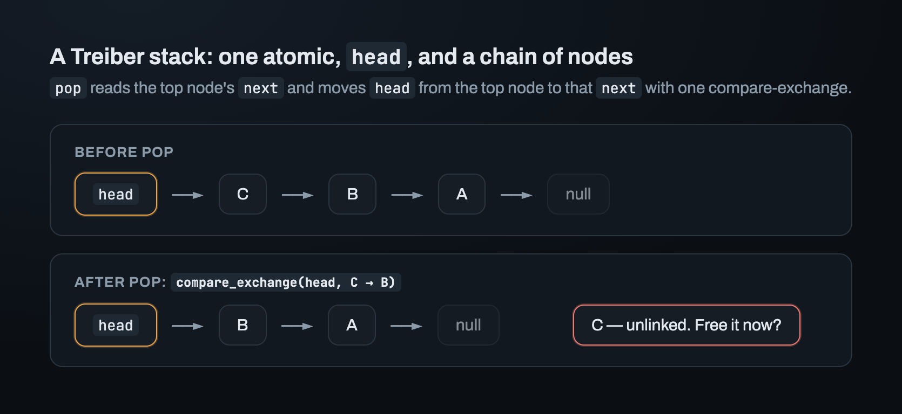
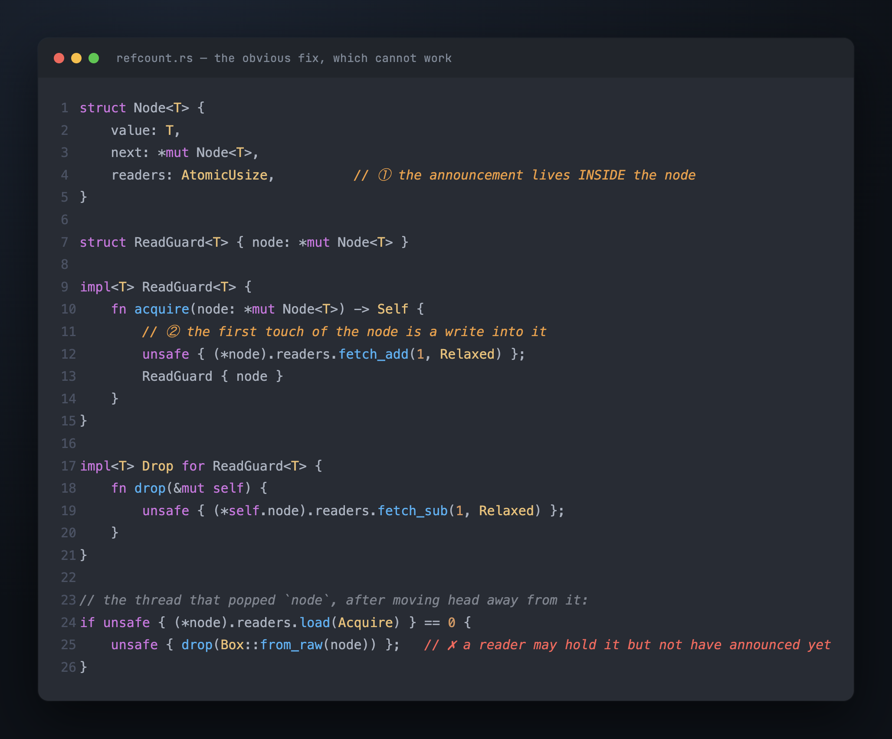
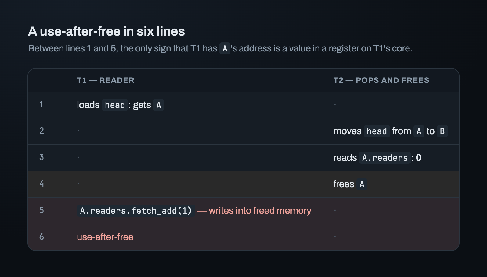
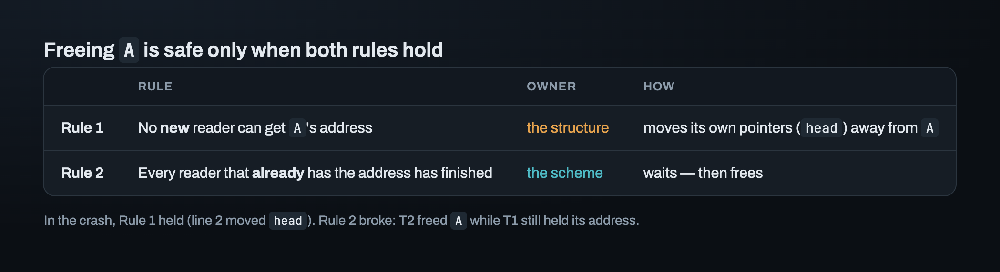
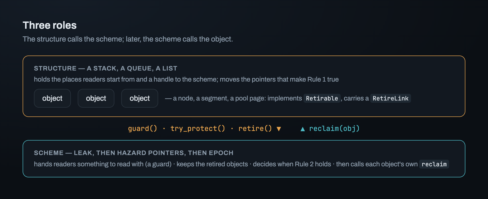

# Part 1 — The problem: freeing memory another thread may be reading

Two threads share a lock-free stack. Thread 1 loads the top node's address. Thread 2
pops that same node with one `compare_exchange` and frees it with one call to `free`.
Thread 1 now reads the node's `next` field. That's four instructions, two cores, and a
read of freed memory. No test will reliably catch it, because the gap between Thread 1's
load and its read is only a few nanoseconds.

Every lock-free linked structure has this problem: stacks, queues, lists, skiplists,
hash tables with chained buckets. Unlinking a node (removing it from the structure) and
freeing it are two different moments. In Java or Go the garbage collector decides when
to free the node, so the problem doesn't exist. Rust has no collector. Something has to
decide when unlinked memory may be freed, and it can't take a lock to do it.

Making that decision is called **safe memory reclamation**. This series builds a crate
for it, `reclaim`, from an empty `lib.rs`. It's a design investigation, not a tutorial.
Every choice is forced by a crash, a tool, or a measurement. The series also shows the
mistakes made along the way. Part 1 defines the problem, shows why the obvious fix can
never work, and ends with what the crate has to offer.

## A Treiber stack: the smallest structure with this problem

A Treiber stack is one atomic, `head`, pointing at a chain of nodes. `push` and `pop`
are each a compare-exchange on `head`.

`pop` loads `head`, reads the top node's `next`, and moves `head` from the top node to
`next`. Once that compare-exchange succeeds, the node is unlinked. No new thread can
find it.

So free it right there? That's the bug in the opening paragraph. Between loading `head`
and reading the top node's `next`, a thread has the node's address only in a register.
In that gap, another thread can pop the node and free it.

## The obvious fix: count the readers

Give each node a counter. Before a thread uses a node, it increments the counter to
announce "I'm reading this node". It decrements the counter when it's done. The thread
that unlinked the node frees it only when the count is zero. That's how `Arc` works, so
it feels safe.

## A use-after-free in six lines

`T1` is about to read node `A`. `T2` pops `A` and wants to free it.

Look at line 5. `T1` does nothing wrong. Its very first touch of `A` is the increment,
and the increment writes *into `A`*. By then `A` is gone.

Between lines 1 and 5, the only sign that `T1` has `A`'s address is a value in a
register on `T1`'s core. Nothing in shared memory has changed, so no other thread can
know. That's why `T2` reads a count of zero. By the counter's own rules, zero is the
correct answer.

> **A counter inside the object can't protect the object: announcing "I'm reading it"
> already touches it.**

No choice of memory ordering fixes this, and neither does a smarter counter. Any design
that stores the announcement *inside the thing being protected* has the same flaw. The
idea itself fails, not the code. (`Arc` is safe because you can only reach an `Arc`'s
memory through an `Arc` you already own. A lock-free structure hands out bare
addresses.)

## Two rules for freeing safely, each with its own owner

So what has to be true before `A` may be freed? Write the sentence "freeing `A` is safe
because ___" and try to finish it. You need two separate rules to fill in the blank.

**Rule 1: no *new* reader can get `A`'s address.** In the crash this held: line 2 moved
`head` past `A`. To make it true, the structure changes its own pointers. How it changes
them is part of the structure's algorithm. A stack, a queue, and a sorted list each do
it differently.

**Rule 2: every reader that *already* has the address has finished with it.** In the
crash this is what broke. `T1` got the address before line 2 and was still going to use
it.

The structure can't own Rule 2. It doesn't know which threads hold which addresses. That
knowledge has to be collected somewhere outside the object, by a third party. This crate
calls that third party a **scheme**.

The scheme can't own Rule 1. It only sees the addresses it's handed. It has no pointers
to move. It can *check* Rule 1 if it's told where readers start from (Part 2), but it
can never make it true.

## Retire, then reclaim

Splitting the job this way gives us two words for two moments.

- **retire** — once Rule 1 holds, the structure says "I'm done with `A`" and hands `A`
  to the scheme. Nothing is freed.
- **reclaim** — later, when the scheme knows Rule 2 holds, it frees `A`.

The wait in between is the **grace period**. During it `A`'s memory is still alive, and
the scheme owns it. Readers that took `A`'s address before it was retired can finish.

That's the whole job of the crate, in one line: **accept retired objects, and reclaim
each one as soon as no reader can still hold it, without making any reader take a
lock.**

## Three roles: object, structure, scheme

- the **object**: the thing that gets freed. A stack node, a queue segment, a page from
  a pool.
- the **structure**: the thing that contains objects and moves the pointers that make
  Rule 1 true.
- the **scheme**: the third party that knows when Rule 2 holds.

The structure calls the scheme: "give me something to read with", "I'm reading this
one", "I'm done with this one". Later the scheme calls the object: "free yourself".
Every type in the crate represents one of these roles or one of these calls.

## What the crate has to offer

There are two classic schemes, and they answer Rule 2 in opposite ways. **Hazard
pointers** make each reader publish the *address* it's reading, that is, write it where
other threads can see it. **Epoch-based reclamation** makes each reader publish *when*
it started reading. Part 3 explains how each one works. Each is cheap on some code paths
and costly on others, so which one wins depends on the structure and the workload.

Existing libraries pick one. `crossbeam-epoch` uses epoch-based reclamation, and
`haphazard` and the `hazptr` module of folly (Meta's C++ library) use hazard pointers.
`reclaim` has four requirements, and none of those libraries meets all four:

1. **One interface over both schemes.** A structure is written once, and the scheme is a
   type parameter. Then a benchmark can keep everything the same except the scheme.
   That's the only honest way to compare the two.
2. **Objects free themselves in their own way.** For example, a node allocated with
   `Box`, a page that has to go back to a pool, or an entry in an arena. The scheme
   decides *when*, and the object decides *how*.
3. **No allocation to retire.** The scheme has to keep retired objects somewhere.
   Allocating a list node for each retired object would put `malloc` on the hot path.
4. **Rule 1 checked, not only documented.** The structure tells the crate where its
   readers start. In a debug build, `retire` checks that none of those places still
   points to the object being retired.

The plan has three schemes. First comes `Leak`, which never frees anything. It exists so
everything else can be built and tested first. Then come hazard pointers, then epoch.

## Where this leaves us

Rule 2 is the scheme's job, and Rule 1 is the structure's. Before building any scheme,
we need to know how a structure makes Rule 1 true at all. "No new reader can get the
address" depends on where readers get addresses *from*. That turns out to be a small set
of places. If a structure gets this set wrong, its objects can never be freed.

---

*Next: [Part 2 — Roots: where every reader starts](02_roots.md) · [Index](00_index.md)*
