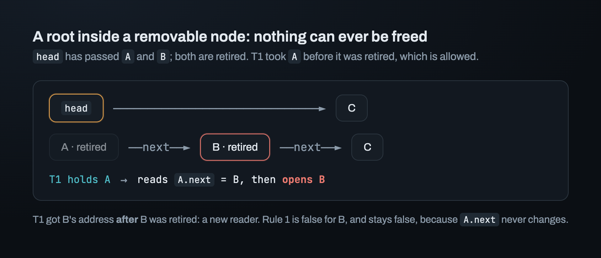
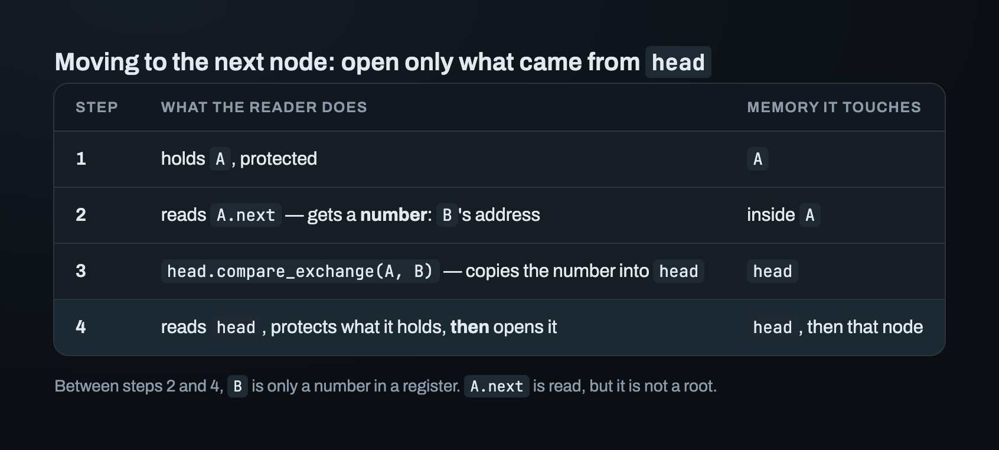
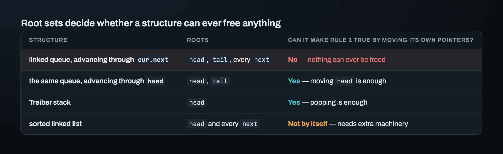
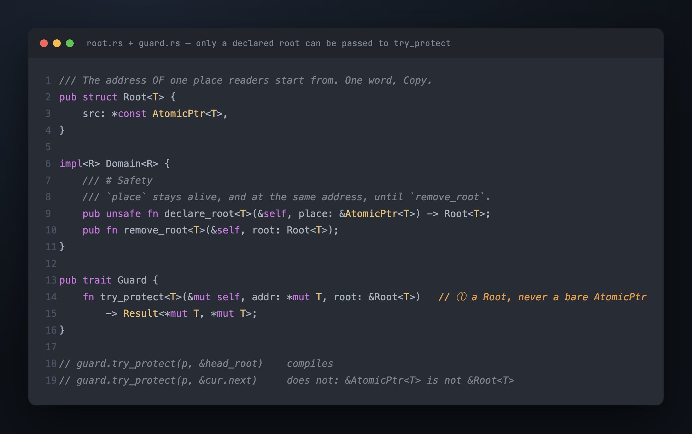

# Part 2 — Roots: where every reader starts

A thread can't invent an address. Every pointer it dereferences was loaded from some
place in shared memory: `head`, `tail`, a field inside another object. Rule 1 from Part
1 — no new reader can get the address — is therefore a statement about those places. If
you know every place a reader starts from, you know whether an object can still be
reached.

This part defines which of those places are roots. It shows a queue that can never free
anything because it reads addresses from the wrong place. Then it decides how the crate
should know about those places: from a comment, or from the type system.

## Reading a place is not the same as protecting through it

A reader can do two different things with a place.

- **Read a number from it.** Load the address and keep it in a register: compare it,
  copy it into another atomic, pass it as a `compare_exchange` argument. An address in a
  register is just a number. Nothing is opened.
- **Protect through it.** Load the address, tell the scheme "I'm reading this one" (that
  is what *protect* means), and then *open* the object: dereference it.

> **A place is a root only if a reader loads an address from it and then opens the
> object at that address.**

The difference sounds small. It decides whether a structure can ever free anything.

## When `next` becomes a root

Take a linked queue: a chain of nodes, `head` at the front, `tail` at the back. A
consumer is reading node `cur`. When it's done with `cur`, the natural way to move on is
to load `cur.next` and open that node. Written that way, every node's `next` is a root.



`head` has already passed `A` and `B`, and both were retired. `T1` still holds `A`,
which is allowed; it took `A` before `A` was retired. Now `T1` reads `A.next`, gets
`B`'s address, and opens `B`.

`T1` got `B`'s address *after* `B` was retired. It's a new reader of `B`, so Rule 1 is
false for `B`. Nobody can fix it. `next` is written once and never changes, so the queue
can't remove `B`'s address from `A.next`. The scheme can only check Rule 1, not make it
true.

While `A.next` is a root, there's always a path to `B`, so `B` can never be freed. The
same holds for every node. This isn't a bug in one line of code. It comes from the
queue's **root set**, the set of all its roots. With this root set, Rule 1 is
impossible.

## The fix: open only what came from `head` or `tail`

The consumer still needs `B`'s address to move forward. It just never opens `B` with an
address it got from `A`:



Between steps 2 and 4, `B` is only a number in a register. The node the reader opens in
step 4 got its address from `head`. So `A.next` is read but isn't a root, and the root
set shrinks to `{head, tail}`.

With that root set, Rule 1 holds as soon as `head` moves past a node. Moving the
structure's own pointer is enough.

## Which structures make Rule 1 true by moving their own pointers?



The sorted linked list is the hard case. A reader searching it walks node by node and
*opens* each one. So every `next` is a root, and the list can't avoid that the way the
queue did. A reader holding a node that was just removed can still follow its `next` to
a later node that has also been removed. Lists need extra machinery. It comes much later
in the build.

> **When a root lives inside an object that can be removed, Rule 1 breaks.** `head` and
> `tail` are safe roots because they're fields of the structure, and the structure is
> never retired.

## Should roots be declared in code, or only documented?

So a structure has a root set, and correctness depends on it. How does the crate know
what it is?

The conventional answer is documentation: "protect only through your structure's roots".
Every reclamation library I checked does that. I rejected that answer: *I don't want to
solve a problem and then rely on a document to keep it solved.*

The strongest case for documentation was a test-only check. The structure registers its
roots only in tests, so the public API stays the same. A debug check then verifies that
nothing retired is reachable from those roots. This idea fails, and the way it fails
shows what the bug really is:

> **The bug is the gap between the root set you believe in and the one your code uses.**
> The queue above *believes* `{head, tail}` while protecting through `cur.next`. A check
> that is given `{head, tail}` walks `head` and `tail`, finds the retired node
> unreachable, and passes.

Any check that trusts the root set it is given can't see this bug. The opposite approach
fails in a different way. It watches, at runtime, which places threads protect through.
But a place it saw can be inside an object that is later freed. Then the check itself
reads freed memory: a use-after-free.

What's left is to make the root set part of the API. A structure declares each root once
and gets back a `Root<T>`. `try_protect`, the call that protects an object, takes a
`&Root<T>`, never a bare `&AtomicPtr<T>`.



`cur.next` isn't declared, so it can't be passed. The broken queue doesn't even compile
against this signature: the type system now rejects the root set that made reclamation
impossible.

## What declared roots give you at runtime

The domain is a handle around one scheme (Part 4 builds it). It keeps the declared roots
in a list, the root registry. In a debug build, `retire` walks the registry and asserts
that no root still holds the object being retired:

```rust
#[cfg(debug_assertions)]
assert!(
    !self.inner.roots.any_root_holds(obj.cast()),
    "retire: a root still holds this object (Rule 1 is broken)"
);
```

In a release build the registry is a struct with no fields. Its `declare` and `remove`
methods have empty bodies, and a test asserts `size_of::<RootRegistry>() == 0`.
Production pays nothing.

The check has limits. They are written down, so a passing run never claims more than it
checked. The check catches an object a root holds *at the moment of retire*. It doesn't
catch one that becomes reachable again later. It's debug-only, and it says nothing about
production.

Three things in `Root<T>` are deliberate:

- **One word, `Copy`.** It's the address of the `AtomicPtr`, nothing more. A structure
  stores one per root and passes it by reference on every call to `try_protect`.
- **A raw pointer, not a lifetime.** If `Root<'a, T>` borrowed the structure's field,
  the structure itself would need a lifetime. Instead, the caller of `unsafe fn
  declare_root` promises that the place stays alive, *and at the same address*, until
  `remove_root`. Part 5 shows how easy it is to break the second condition: staying at
  the same address.
- **`Send` and `Sync` for any `T`**, implemented by hand. `AtomicPtr<T>` is also `Send`
  and `Sync` for any `T`. A root shares an address, never a `T`.

The cost was about four hours of work, plus a `Root<T>` parameter in the public API.
That parameter can't be added later, so it had to be there from the start. In exchange,
every retire in every debug run checks Rule 1 against the root set the code *actually*
uses. A check that trusts a comment can't do that.

## Where this leaves us

Rule 1 now has a mechanism: the structure moves its declared roots, and a debug check
verifies Rule 1 at every retire. Rule 2 is not solved yet. A reader holding `A` has to
tell the scheme that it holds `A`, *without* writing into `A`. There are two ways to do
that, and they lead to two different meanings of the word "guard".

---

*Next: [Part 3 — Two ways to say "I'm reading"](03_guards.md) · Previous: [Part 1](01_the_problem.md) · [Index](00_index.md)*
