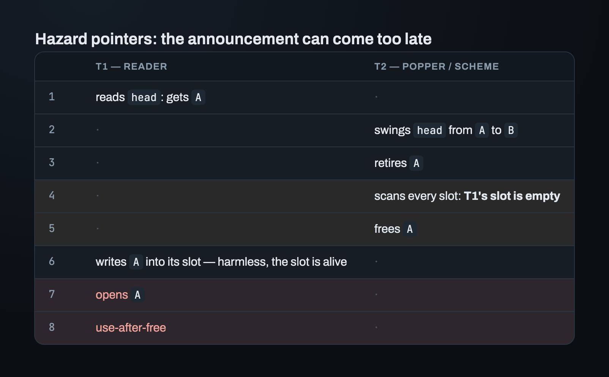
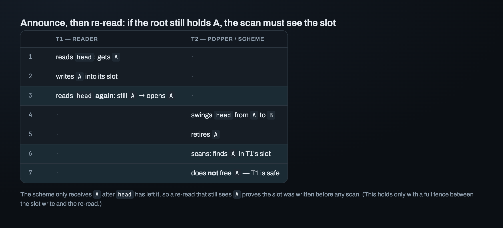
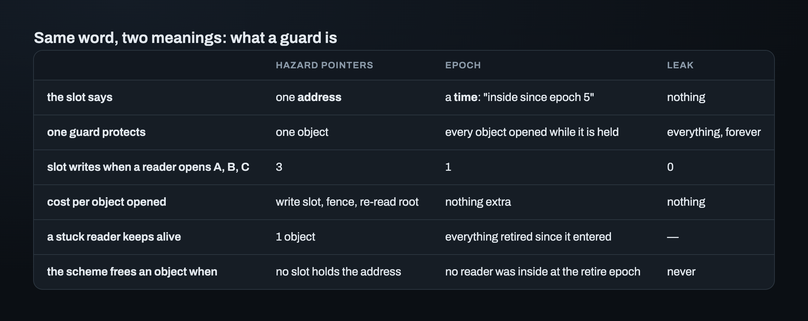
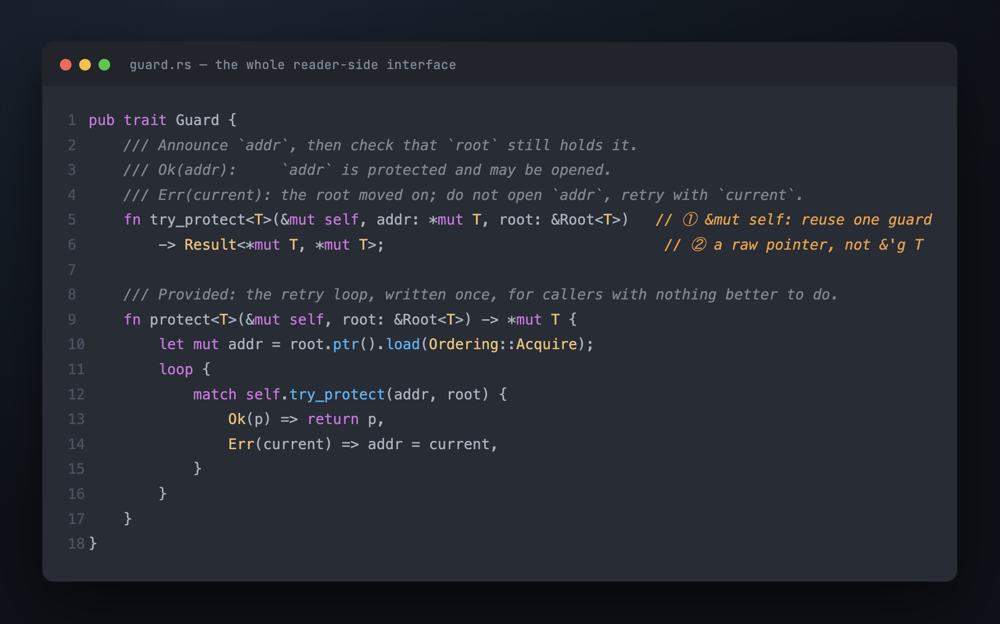

# Part 3 — Two ways to say "I'm reading"

Rule 2 says every reader that already holds an address must have finished with it before
the object is freed. Part 1 showed that a reader can't announce "I'm reading" by writing
into the object. So it has to write somewhere else, somewhere that's alive for the whole
program and that the scheme can look at. Call it a **slot**: one small piece of shared
memory, owned by the scheme. (Part 9 builds the slots, and shows why hazard pointers
give each guard its own slot while epoch gives each thread one.)

A **guard** is what a reader holds while its announcement is in its slot. Dropping the
guard clears the slot. Both classic schemes, hazard pointers and epoch, agree on that
much. They disagree about what goes *in* the slot. That one choice decides almost
everything else, including the shape of one trait that covers both.

## Way 1: write the address (hazard pointers)

The reader writes "I'm reading the object at this address". Before freeing `A`, the
scheme looks through every slot. If no slot holds `A`'s address, it frees `A`.

Writing the slot isn't enough on its own, because the announcement can come too late:



The write in line 6 is harmless, since the slot is always alive. The problem is that the
scheme looked at the slots at line 4 and found nothing. So the reader adds a third step:

1. read the root (`head`), get an address;
2. write that address into the slot;
3. **read the root again and compare.** Same address: open it. Different: start over
   with the new one.

Why does the second read make it safe? If the addresses differ, the reader doesn't open
anything. If they match, then `head` still held `A` *after* the slot was written. The
scheme only receives `A` (through `retire`) after `head` has moved away from it. So the
slot was written before the scheme could look, and the scheme's scan is certain to see
it.



(For the scan to be certain to see the slot, the slot write and the re-read need a full
fence between them: an instruction that makes the slot write visible to other cores
before the re-read happens. That fence is the most expensive thing hazard pointers do,
and a later part, on the hazard-pointer scheme, measures it.)

## Way 2: write the time (epoch)

The scheme keeps one global counter, the epoch, and moves it forward from time to time.
When a reader starts, it writes "inside since epoch 5" into its slot. *Inside* means the
reader holds a guard. Then it reads as many objects as it likes, `A`, `B`, `C`, `D`,
without writing anything else.

When `A` is retired, the scheme labels it with the current epoch. It may free `A` once
no slot shows a reader that was already inside at that epoch. A reader that entered
*after* `A` was retired can't hold `A`, because Rule 1 was already true when it started.

The scheme never learns which objects a reader opened. It only asks one question: *was
this reader already inside when the object was retired?*

## "Guard" means two different things



A hazard-pointer guard protects **one object**, and the reader pays on every object it
opens. An epoch guard protects **everything opened while it's held**. The reader pays
almost nothing per object. But if one reader gets stuck while holding its guard, no
object retired since it entered can be freed.

> **Hazard pointers know exactly which objects each reader holds, and pay on every
> object opened. Epoch knows only when each reader started, and pays by freeing memory
> later.**

One interface for both schemes has to fit the stricter one, hazard pointers. Hazard
pointers need to know *which* object, and *from which root*, so they can re-read the
root. Epoch can use the same interface and simply do nothing per object.

## The reader trait: `Guard`



That's the whole reader-side interface. Four decisions are packed into it, and in each
one the obvious answer was the wrong one.

## Reuse one guard; don't make a new one

The first argument was a count. A new guard for every pointer load costs one slot per
load. Re-pointing one guard (writing each new address into the same slot) costs one slot
per operation. In `pop`'s retry loop, N attempts cost N slots instead of 1.

That count was correct, but it wasn't the real reason to reuse the guard. Making a new
guard per load *can't express* "stay protected across a retry". You either drop the old
guard first, which leaves an unprotected window, or you hold both, which uses two live
slots where one is enough. So `try_protect` takes `&mut self` and overwrites the slot in
place. One guard per operation.

## No loop hidden inside the library

The natural API is `protect(root) -> *mut T`, which loops until the announcement is
confirmed. But a hidden loop spins inside a library call an unknown number of times. It
also retries on the same condition as the caller's own loop: the root changed. Only the
caller knows what the pointer was for. When the hidden loop runs inside the caller's
loop, the costs multiply: inner × outer instead of inner + outer. And each inner
iteration costs a hazard-pointer fence.

So `try_protect` is the only required method. It makes one attempt. If the root no
longer holds `addr`, it returns `Err(current)`, where `current` is what the root holds
now. `protect` is a *provided* method, a default loop that calls `try_protect`, for
callers who really have nothing better to do on a retry.

## `Ok` means "safe to open", not "still in the root"

Should `Ok(p)` promise that `p` is still in the root? It sounds stronger. But it doesn't
stay true for long. By the time the caller acts, the root may already hold something
else. And a caller that changes the structure checks again anyway, with its own
compare-exchange.

So `Ok(p)` promises only that `p` is safe to open. Hazard pointers still re-read,
because their own safety argument needs it. Epoch returns `Ok(addr)` immediately and
does no load at all, which keeps a load off epoch's hottest path. (An early draft added
that load only so a test would run the same steps under every scheme.)

## `try_protect` returns a raw pointer, not a reference

Returning `&'g T` tied to the guard would let the borrow checker stop a reader from
using a pointer after re-pointing its guard. It would also forbid `swap(a, b)` on two
guards, because `swap` needs `&mut` access to both guards while a reference from one of
them is still alive. A list traversal uses that swap to step forward with two guards:
one on the current node and one on the next.

So `try_protect` returns `*mut T`, and it's a **safe** `fn`. Writing an address into a
slot can't hurt anything. The dangerous part is opening the object, and that happens in
the caller's own `unsafe` block, with a `// SAFETY:` comment that names the guard.

The cost is that the compiler no longer ties a pointer to its guard. If a reader uses a
pointer after re-pointing its guard, Miri (an interpreter that runs Rust code and
reports undefined behavior) can catch it in a client's tests. The compiler can't. The
trait accepts that cost because it must also work for hazard pointers, and hazard
pointers have no pointer type whose lifetime is tied to a guard. Epoch can still offer
its own API, with lifetime-checked pointers, next to the trait. That comes later.

## The scheme trait: `Reclaimer`

The scheme side is smaller:

```rust
pub unsafe trait Reclaimer {
    type Guard: Guard;
    fn guard(&self) -> Self::Guard;
    unsafe fn retire<T: Retirable>(&self, obj: *mut T);
}
```

Each scheme brings its own guard type. A structure that is generic over `R: Reclaimer`
compiles to direct calls, with no dynamic dispatch. Two `unsafe` keywords, two different
promises:

- `unsafe trait Reclaimer`: the *implementor* promises Rule 2. It never frees an object
  a guard still protects.
- `unsafe fn retire`: the *caller* promises three things. No root can still lead to the
  object (Rule 1), it's retired only once, and the caller doesn't use it afterwards.

## Where this leaves us

A reader can now say "I'm reading this", and a structure can say "I'm done with this".
What happens to an object between `retire` and `reclaim`? It sits somewhere, owned by
the scheme, mixed with retired objects of other types. Later the scheme tells it to free
itself, and only the object knows how. Part 4 covers what an object has to promise to
be kept there. Part 6 builds the place itself.

---

*Next: [Part 4 — What an unsafe trait promises](04_the_contract.md) · Previous: [Part 2](02_roots.md) · [Index](00_index.md)*
