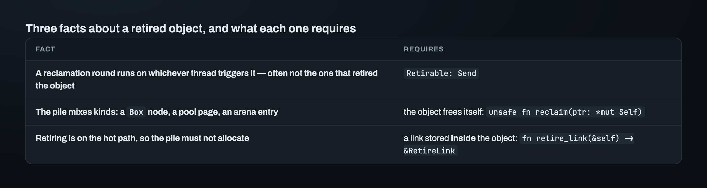
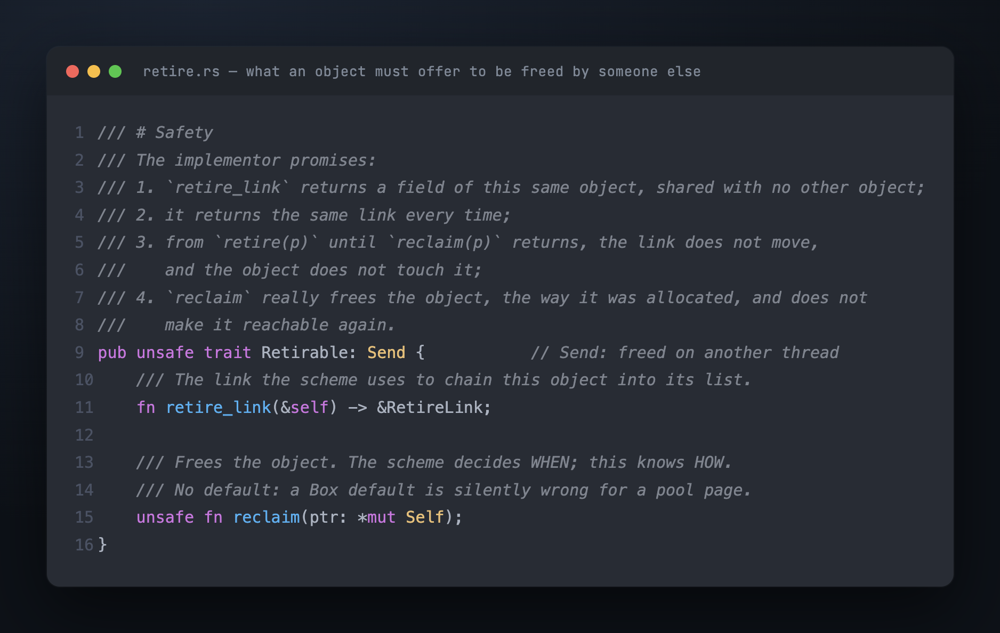
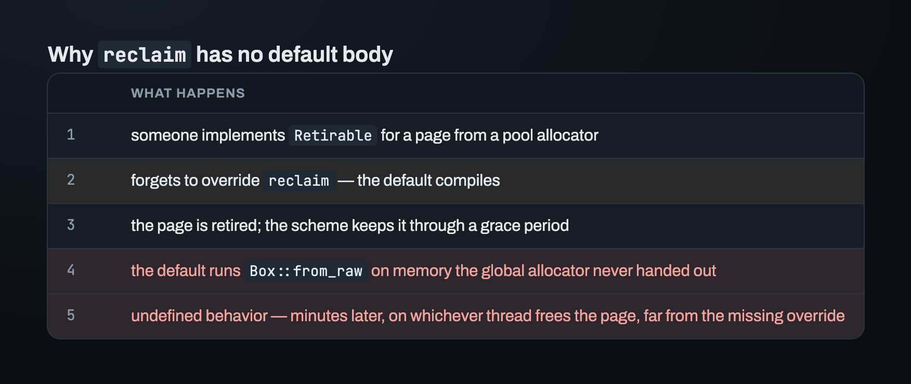
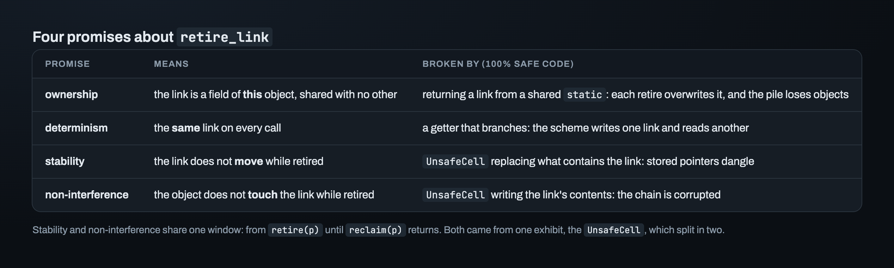
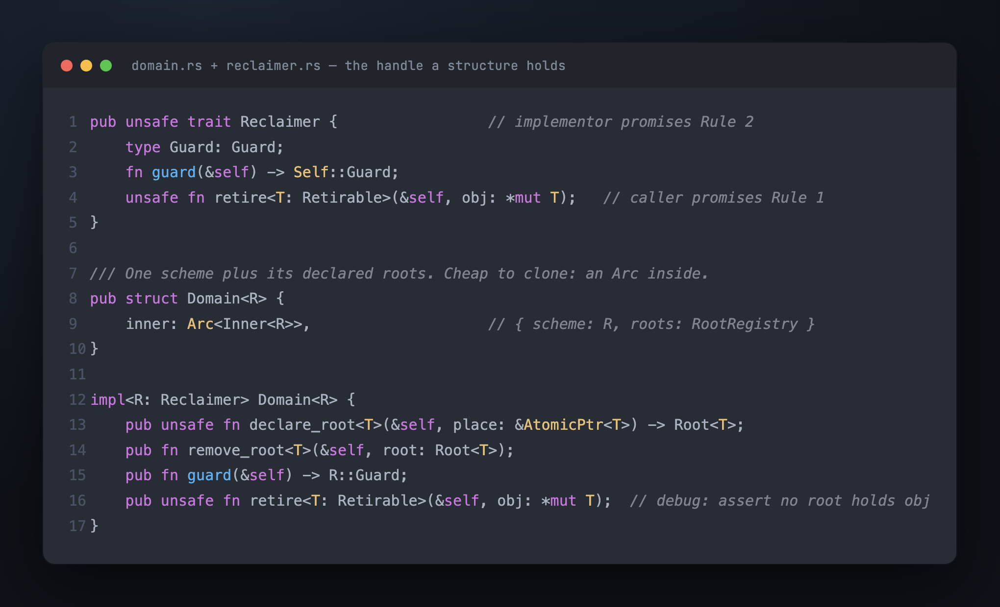
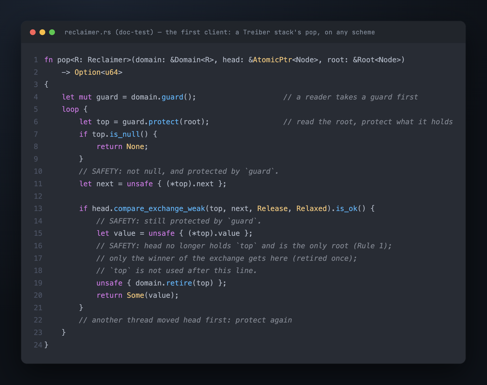

# Part 4 — What an unsafe trait promises

After `retire(A)`, the scheme owns `A` until it frees it. One scheme serves every
structure that uses it. So the scheme's list of retired objects, which this series calls
the **pile**, holds objects of many kinds: a stack node made with `Box::new`, a queue
segment, a page that has to go back to a pool. The scheme can't know their types. But
later, some thread has to free each one correctly, and it can be any thread.

This part works out what an object has to offer to live on that pile, and then what it
has to *promise*. The promises are the harder half: the compiler can check what an
object offers, but not what it promises.

## Three facts about a retired object

**It's freed on another thread.** The scheme frees retired objects in batches, and
freeing one batch is called a **reclamation round**. A round runs on whichever thread
triggers it, which is often not the thread that retired the object. So the object's type
must be `Send`.

**The pile mixes kinds.** Freeing a `Box` and returning a page to a pool need different
code, and the scheme can't know which one an object needs. So the object carries its own
deallocator: the scheme decides *when*, the object knows *how*.

**Retiring can't allocate.** It's on the structure's hot path, and a `malloc` there
would slow down every retire. So each object carries a small field, a **link**, that the
scheme uses to chain it into the pile. The link is stored *inside* the object.

Each fact becomes one part of the trait:

## No default for `reclaim`

The first instinct was a default body, `drop(Box::from_raw(ptr))`. It's the common case,
so why make every implementor repeat it?

Because that default is silently wrong for exactly the objects that need their own
`reclaim`:

> **A bad default is worse than no default. Without a default, a missing `reclaim` is a
> compile error. With a bad default, the code compiles and is silently wrong.**

So there's no default. Every implementor writes a three-line `reclaim` that calls its
own deallocator. (A default wouldn't even compile as written: `Self` in a trait is
implicitly `?Sized`, and `Box::from_raw` needs `Sized`.)

## Why the trait is `unsafe`

The first version built cleanly as `trait Retirable: Send`, with no `unsafe`. It
compiled, the tests passed, and it was unsound: safe code could break memory safety
through it.

`unsafe fn` and `unsafe trait` constrain different people:

- `unsafe fn` constrains the **caller**. The compiler enforces it: you can't call one
  without an `unsafe` block.
- `unsafe trait` constrains the **implementor**. The compiler only checks that every
  implementation is written as `unsafe impl`. Whether a trait *needs* `unsafe` is a
  judgment the trait's author makes.

The test for that judgment:

> **Could an implementation written in 100% safe Rust break memory safety?** If yes, the
> trait must be `unsafe`.

For `Retirable` the answer is yes. Three safe implementations show it. A `retire_link`
that returns a link from a shared `static`: every object gets chained through the same
field, and each retire overwrites it, so the pile loses the earlier objects. A getter
that returns a different link on each call: the scheme writes into one and reads the
other. A link inside an `UnsafeCell` that the object replaces while it is retired: the
pointer the scheme stored now dangles. Each of those is safe Rust. Each corrupts the
scheme.

So it's `pub unsafe trait Retirable: Send`. A clean build isn't evidence that a trait is
sound. For anything with an `unsafe trait` in it, "compiles and tests pass" isn't enough
to call it done. The test above has to be applied by hand.

## Four promises about `retire_link`

Call each of those three examples an **exhibit**: a concrete trace that ends in a named
failure. Writing the exhibits out found more promises than expected. The starting
assumption was two promises: the link belongs to this object, and it's the same link on
every call. The third exhibit, the `UnsafeCell`, splits in two. Mutating what *contains*
the link moves its address. Mutating the link's *contents* corrupts the chain. One
mechanism, the `UnsafeCell`, causes two different failures, so the contract needs a
separate promise for each.

The last two must hold during the same window of time, and it can be stated exactly:
from `retire(p)` until `reclaim(p)` returns. Naming the window turns a vague rule,
"leave the link alone", into one a reviewer can check. `reclaim` adds a fifth promise:
it really frees the object exactly once, the way it was allocated, and doesn't make it
reachable again. The trait's `# Safety` comment above lists all five in four items: item
3 covers both stability and non-interference.

The general lesson: work from exhibits. Write the trace first, then write the promise
that the trace breaks. Non-interference, the fourth promise, wasn't found by thinking
about promises. It came from the `UnsafeCell` trace.

## The handle a structure holds

A structure doesn't call a scheme directly. It holds a `Domain<R>`: a handle to one
scheme and its root list, the declared roots from Part 2. The handle is cheap to clone,
because inside it is just an `Arc`.

Two choices here went against the obvious answer:

- **No type-level domain families.** Some designs give each domain its own type, called
  a *family*, and mark each pointer's type with it. That sounds safer, but it's where
  `haphazard` went unsound: its open issue #54 shows `unique_domain!` creating two
  domains that share one family. Instead, a structure *stores* the domain it was built
  with. So an object can't be retired in one domain while a guard from another domain
  protects it, and no type parameter is needed for that.
- **No default scheme parameter.** `Stack<T, R = Leak>` would save typing at every call
  site. It would also mean someone writes `Stack<u64>` and silently gets an unbounded
  leak.

## `Leak`, the first scheme

`Leak` accepts retired objects and never frees them. Its guard holds nothing,
`try_protect` returns `Ok` at once, and `retire` does nothing. It isn't a joke. It's a
scheme that can exist before any of the hard parts are written. So the interface and its
first clients, the structures that use it, can be built and tested against something
real. And as a type parameter, `Stack<u64, Leak>` *names* the leak. The leak is then
expected behavior, and a test can check that it really happens, for example that no
retired object is ever freed.

## The first client: a Treiber stack

The crate's documentation includes a working Treiber stack that runs on `Leak`. It is a
doc-test, an example that is compiled and run with the tests, so it can't go out of
date. Its `pop` goes through every step of an object's life in about fifteen lines: take
a guard, protect through the root, open the node, move the root away, retire.

Every `unsafe` in it has a `// SAFETY:` comment, and each comment points at a promise
from this part or Part 3. That's how to judge a contract: a client can be written
against it, and every dangerous line can say why it's safe.

## Where this leaves us

The contract is in place, one scheme implements it, and a short stack uses it. One
promise is still easier to state than to keep. The caller of `declare_root` promises
that the place stays alive, at the same address, until `remove_root`. Keeping it inside
an ordinary Rust struct took three attempts, and only one tool could see the difference
between the second and the third.

---

*Next: [Part 5 — Where a root lives, and what only Miri saw](05_where_a_root_lives.md) · Previous: [Part 3](03_guards.md) · [Index](00_index.md)*
