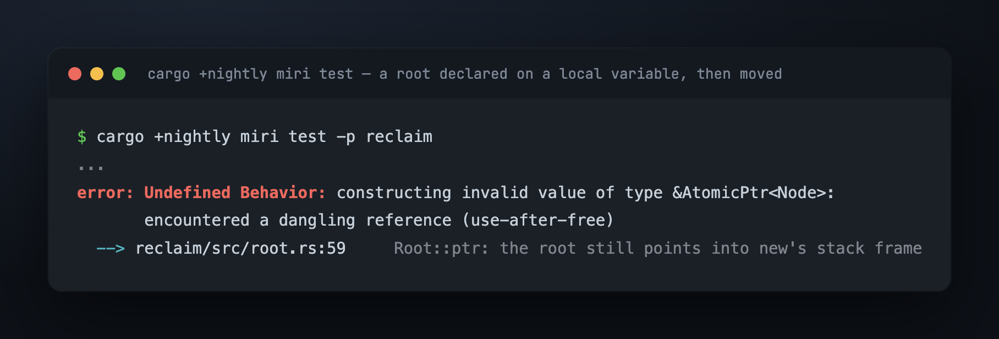
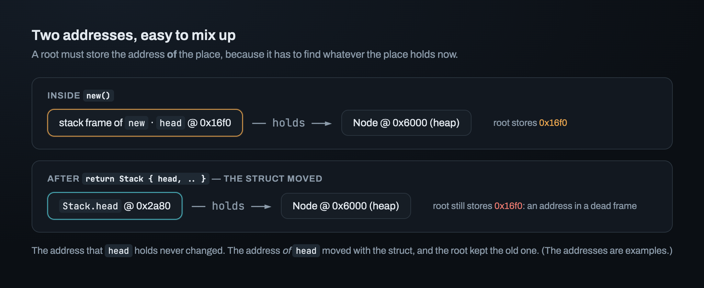
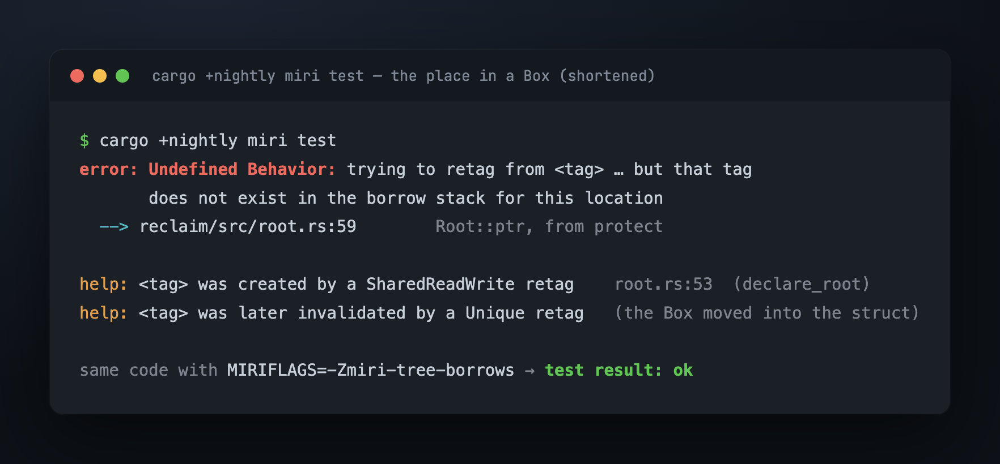
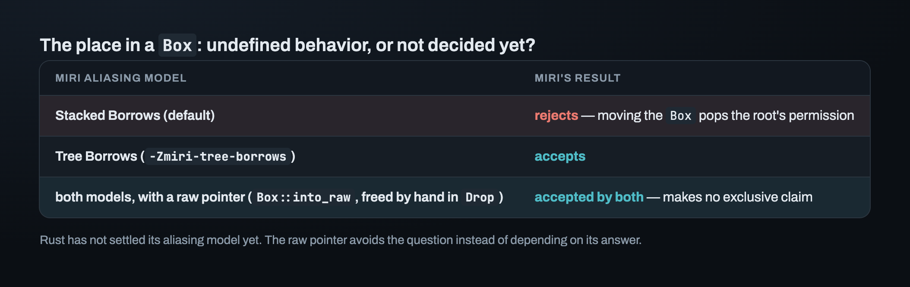
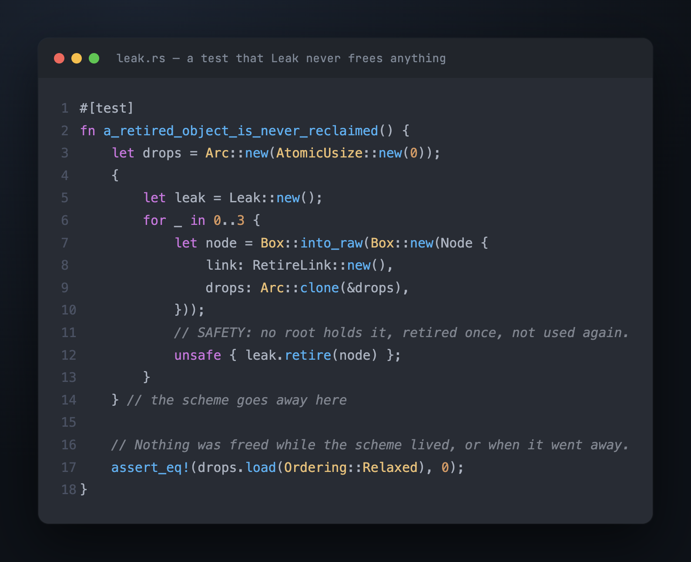

# Part 5 — Where a root lives, and what only Miri saw

`declare_root` is an `unsafe fn` with one promise attached: the place you declare
**stays alive, and stays at the same address, until `remove_root`**. The domain keeps
the place's address, not a borrow of it. Two things read through that address: every
guard that protects through the root, and the debug check on every `retire`.

The promise looks easy to keep. Keeping it for a place inside an ordinary Rust struct
took three attempts. The first two passed every normal test and every loom model (a
small test that the loom tool runs under every interleaving the memory model allows).
Only Miri rejected them. The second rejection turned out to depend on a question Rust
hasn't answered yet.

## Attempt 1: the place as a plain field, declared in `new`

A structure owns its roots, so `head` naturally goes in a field. Build it in `new`,
declare it, and return the struct:

```rust
fn new(domain: Domain<R>) -> Self {
    let head = AtomicPtr::new(null_mut());
    let head_root = unsafe { domain.declare_root(&head) };
    Stack { head, head_root, domain }
}
```

The `SAFETY` comment said `head` is alive. It is. Here is what Miri reports for a
ten-line test that does exactly this:



Returning a value moves it. The root still held the old address of `head`, inside
`new`'s stack frame. That frame is gone once `new` returns.

There are two addresses here, and they're easy to mix up:



The address that `head` *holds* points at a node on the heap, and that node doesn't
move. The address *of* `head` is where that field sits in memory, and it changes every
time the struct moves. A root has to store the second, because it must find whatever the
place holds *now*. Every later move breaks the root the same way: into an `Arc`, into a
`Vec`, or out of a function. Each one is safe code that a user is free to write.

So the place has to live somewhere that doesn't move when the struct does: the heap.

## Attempt 2: the place in a `Box`

The field becomes `head: Box<AtomicPtr<Node>>`. Moving the struct copies only the
`Box`'s pointer, and the `AtomicPtr` on the heap stays where it is. This is correct: the
address never changes.

Miri rejected it anyway, in every test, at the first use of the root:



The address was fine. The root's *permission* to use it wasn't. A `Box` is an exclusive
owner, like `&mut`. The compiler may assume nothing else reaches the memory while the
`Box` is in use. Miri models that as a stack of permissions per location. `declare_root`
added the root's permission on top of the `Box`'s. Moving the `Box` into the struct
counts as a use of the exclusive owner. That use removes every permission above the
`Box`'s. The `AtomicPtr` did not move and was not freed, but the root's permission was
gone.

## Is the `Box` version undefined behavior, or not decided yet?

Rust hasn't settled its aliasing model yet: the rules for when two pointers may reach
the same memory. So Miri has two candidate rule sets. The default one, Stacked Borrows,
is the stack of permissions above. The other is Tree Borrows. Same code, same test:



So the honest statement isn't "this is undefined behavior". It's "nobody has decided
whether this is allowed". Code that depends on the answer depends on a future version of
the language.

## Attempt 3: the place behind a raw pointer

The place is created with `Box::into_raw(Box::new(AtomicPtr::new(..)))`, stored as `*mut
AtomicPtr<Node>`, and freed by hand in `Drop` after `remove_root`. A raw pointer makes
no exclusive claim, so both models accept it. A lock-free structure already holds its
nodes the same way, because many threads reach them at once.

> **A `Box` gives a stable address, not a shareable one.**

The price is small and visible. Every access to the place goes through an `unsafe`
dereference, kept in one private accessor. And `Drop` now has real work in a fixed
order: remove the root, *then* free the place. In the other order, the domain still
holds the address after the place is freed, and its debug check reads freed memory.

That order exposes a split in the promise itself. "Alive" and "at the same address" are
broken at different moments. A move breaks the second while the structure lives. A
`Drop` that forgets `remove_root` breaks the first after the structure is gone, if the
domain is still alive. So one sentence in the `# Safety` block can be broken in two
separate ways.

## Why the tests didn't see it

On attempt 2, the normal tests passed on every run, and every loom model was green. Neither tool checks for this kind of bug:

- tests check values, and the value read through the root was right every time;
- loom checks orderings between threads, not who may use an address.

Miri is the only one of the three that tracks *permission to use* a pointer. The lesson
isn't "run Miri". It's that each tool is blind to some kinds of bug, so the kind of bug
decides which tool you need. A promise about aliasing needs a tool that checks aliasing:
Miri.

## An `unsafe impl` the compiler never checks

A structure like this stack holds raw pointers, so it has to write its own `Send`/`Sync`
impls. It also holds a `Domain<R>`. The first draft was:

```rust
unsafe impl<T: Send, R: Reclaimer> Send for Stack<T, R> {}
```

It compiled, and every test passed, because `Leak` is `Send + Sync`. But a `Domain<R>`
is an `Arc` around the scheme, and an `Arc<X>` is `Send` only when `X` is `Send` *and*
`Sync`. If you send the structure to another thread and keep a clone of the domain, the
scheme is shared by two threads at once. So the correct bound is `R: Reclaimer + Send +
Sync`.

For an `unsafe fn`, the compiler at least checks that every call sits in an `unsafe`
block. It never checks whether an `unsafe impl` is correct. A test could only fail with
a scheme that isn't `Sync`, and the only scheme so far, `Leak`, is `Sync`. A code review
caught this one, not a tool.

## Testing that `Leak` really leaks

With roots placed correctly, a structure that uses `Leak` runs end to end: declare
roots, take a guard, protect, retire. One test checks that nothing is ever freed, *even
when the scheme itself goes away*:



A scheme that never frees sounds too trivial to test. The test exists for two reasons.
It makes "it leaks" a checked fact instead of an assumption. And when the first scheme
that *does* free arrives, the drop counter is the number that should change.

## Where this leaves us

The interface is done, and its first scheme runs. A client can use it with a `SAFETY`
comment on every dangerous line. Nothing is freed yet. To free anything, a scheme first
needs somewhere to keep retired objects until Rule 2 holds. That is the pile. Many
threads push into it at once, it never allocates, and it holds objects of every type.
It's the crate's first concurrent component. Part 6 builds it for a single thread first.

---

*Next: [Part 6 — The pile of retired objects](06_the_pile.md) · Previous: [Part 4](04_the_contract.md) · [Index](00_index.md)*
