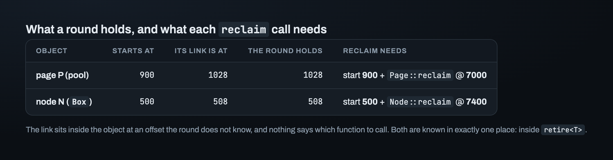
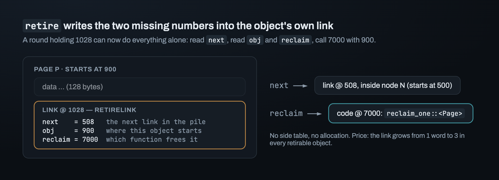
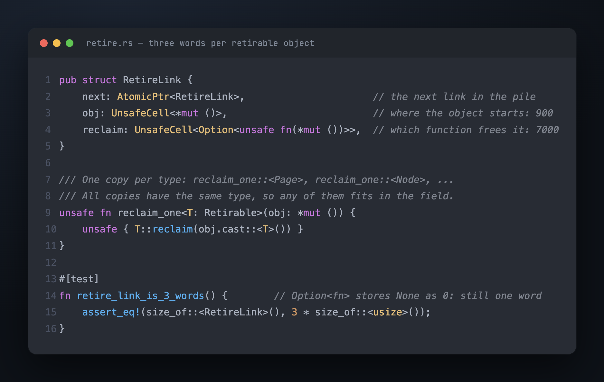
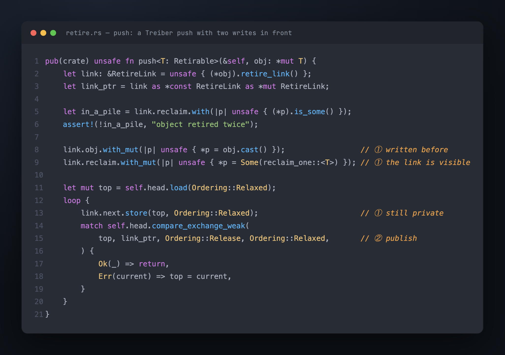
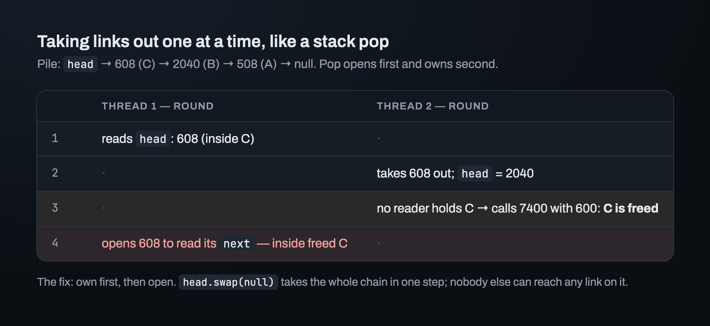
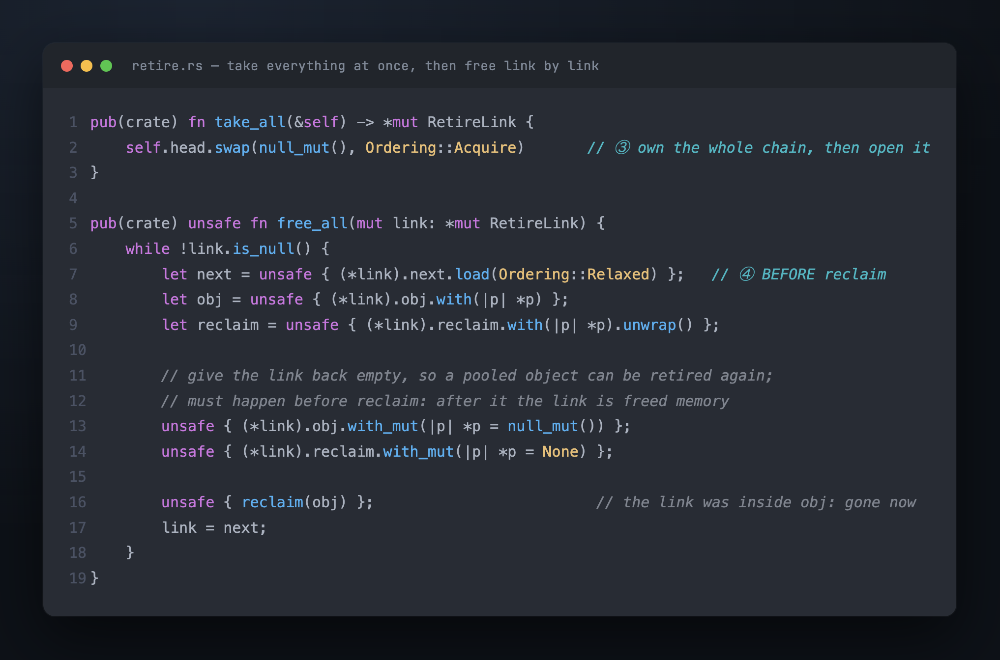

# Part 6 — The pile of retired objects

A reclamation round starts with the retired objects from the pile. Say they are a stack
node and a page from a pool. For each one, the round has to call the right `reclaim`
with the right pointer. But the round doesn't know their types. All it holds is what the
pile is chained through: the address of each object's link.

This part builds the pile one operation at a time: `push`, take, then free. For now,
everything runs on one thread. The design question in each step is the same: what does
this thread know here, and where can it leave what the next step will need?

## What the round has, and what it needs

Two objects, with made-up but realistic addresses:



The round holds `1028`, the address of the page's link. `reclaim` wants `900`, where the
page *starts*. The link sits somewhere inside the object, and the round doesn't know how
far in: 128 bytes for the page, 8 for the node. It also doesn't know *which* `reclaim`
to call.

A function is code, and code has an address too. Say `Page::reclaim` lives at `7000` and
`Node::reclaim` at `7400`. Then "which function" is just another number that can be
stored. So the round needs two numbers per object: `900` and `7000` for the page, `500`
and `7400` for the node.

Where are both known? In exactly one place:

```rust
unsafe fn retire<T: Retirable>(&self, obj: *mut T)
```

Inside `retire`, `obj` *is* the start, and `T` says which function to call:
`T::reclaim`. After `retire` returns, both are gone, unless they were written down
somewhere.

## Store both numbers in the link

A side table in the scheme, `1028 → (900, 7000)`, would work. But it has two costs: it
allocates a row per retire, and every retiring thread writes into the same table. The
pile was supposed to need no memory of its own.

But there's already memory set aside for the scheme in every retired object: the link.
Its doc comment says so: *the field belongs to the object; the value in it belongs to
the scheme.* So `retire` writes both numbers into the link:



Now a round holding `1028` can do everything alone. It reads `next` and remembers it,
reads `obj` and `reclaim`, and calls the function at `7000` with `900`. No table, no
allocation. The price is size: the link grows from one word to three, in every object
that can be retired.

## The Rust types of the link's fields



`obj` has to hold a `*mut Page` in one link and a `*mut Node` in another, so its type is
`*mut ()`: an address with the type removed.

`reclaim` is a function pointer, `fn`, not a closure trait like `FnMut`. A closure can
carry data of any size, so storing one would mean `Box<dyn FnMut>`, which allocates. A
`fn` is always one word.

But `T::reclaim` doesn't fit in that field directly. The field wants `unsafe fn(*mut
())`, and what exists is `Page::reclaim: unsafe fn(*mut Page)`. So the crate adds one
small generic function in between, `reclaim_one::<T>`, which casts back to `*mut T` and
calls `T::reclaim`. The compiler writes one copy per type it's used with, and every copy
has the same type, `unsafe fn(*mut ())`. So the `7000` and `7400` from the example are
really the addresses of those copies: `reclaim_one::<Page>` and `reclaim_one::<Node>`.

> **At `retire` the type is known, so `retire` picks the right copy and stores its
> address. After that, the data no longer carries the type, but the function at that
> address still knows it.**

Two details keep the link at three words:

- A function pointer can never be null, so "no function yet" is `Option<fn>`, starting
  as `None`. Rust stores `None` as zero, so it's still one word. A test asserts
  `size_of::<RetireLink>() == 3 * size_of::<usize>()`.
- `retire_link()` returns `&RetireLink`, and a plain field can't be written through `&`.
  `next` is atomic, so that's fine. `obj` and `reclaim` go in `UnsafeCell`, Rust's
  primitive for writing through a shared reference. They don't need to be atomic, as the
  next section shows.

`UnsafeCell<*mut ()>` is neither `Send` nor `Sync`, so the link lost both, and so did
every object containing one. The crate writes `unsafe impl Send` and `unsafe impl Sync`
by hand, once, on the link, with the reasons in `// SAFETY:` comments. For `Send`: `obj`
is only an address, so moving the link to another thread moves only a number. For
`Sync`: only the retiring thread writes `obj` and `reclaim`, and only before the link is
visible. Only the thread that took the link out of the pile reads them.

## Push: a Treiber stack push with two writes in front

The pile is a Treiber stack of links. `push` is the stack's `push` with two writes in
front:



All three writes (`obj`, `reclaim` and `next`) happen before the compare-exchange.
That's why `obj` and `reclaim` need no atomics. Until `head` holds this link, no other
thread can reach it.

## Take: own the links before you open them

Could a round take links out one at a time, the way a stack pops? Pop reads `head`,
*opens* the top link to read its `next`, then moves `head`. Two threads running rounds:



The stack's `pop` used a guard to make that read safe. But the pile is part of the
scheme, and guards are what the scheme provides. So the pile shouldn't depend on a
guard. Pop *opens* first and *owns* second. The fix is to change the order: *own* first,
then *open*.

`head.swap(null)` takes the whole chain in one step. It writes null and returns the old
chain. The thread that gets the chain owns every link on it, because no other thread can
reach them anymore. A second taker finds an empty pile.

> **Own before you open.** `take_all` is one `swap`, and after it no other thread can
> reach any link the caller is about to read.

## Free: read `next` first

`free_all` goes through the chain that `take_all` returned. For each link it reads
`next`, reads `obj` and `reclaim`, calls `reclaim(obj)`, and moves to `next`.



The order matters. The link lives inside the object, so after `reclaim(obj)` the link is
freed memory. To check that Miri catches this, break the code on purpose (a negative
control): move the `next` read after the call. Miri then reports a dangling reference at
that read.

The first version had a different bug, and no tool found it. It read `obj` and `reclaim`
from `(*next)`, the following link, instead of the current one. It was found while
writing the `// SAFETY:` comment for that line. The comment had to say *which* link was
known to be alive, and the code was reading a different one.

## Retiring the same object twice

Retiring an object twice puts its link on the pile twice. That makes a cycle in the
chain. Later, a round frees the same object twice, far from the code that caused it.
folly checks for this before retiring (`pre_retire_check`). The pile can check too, at
almost no cost: a link that isn't on any pile has `reclaim == None`.

```rust
let in_a_pile = link.reclaim.with(|p| unsafe { (*p).is_some() });
assert!(!in_a_pile, "object retired twice: ...");
```

It's `assert!`, not `debug_assert!`, because it is cheap: the read is one load from a
cache line that `push` is about to write anyway. The check also has limits, and they are
documented. The check catches two retires that are *ordered* (same thread, or a lock or
`join` between them). Two retires at the same instant race on the cell. The check can't
catch that, but loom can (Part 7). Two different wrapper objects around the same memory
can't be caught at all.

For the check to work, something has to set `reclaim` back to `None`. Objects from a
pool come back and get retired again. The first answer was "the object's own `reclaim`
should reset it". But then every implementor would have to remember to do it, and one
who forgets breaks the check for everyone. So `free_all` resets the link itself,
*before* calling `reclaim`. After the call, the link is freed memory. A test retires a
pooled object, frees it, gets it back from the pool, and retires it again.

## Where this leaves us

One thread can push, take and free, and every object is freed by its own `reclaim`,
exactly once. Miri passes and reports no leaks. But the pile exists *because* of other
threads: many retire at once while another takes the whole chain. The writes in `push`
and the reads in `free_all` happen on different cores, and nothing so far makes sure the
thread in `free_all` sees what the thread in `push` wrote.

---

*Next: [Part 7 — One `Release`, one `Acquire`, everything else `Relaxed`](07_orderings.md) · Previous: [Part 5](05_where_a_root_lives.md) · [Index](00_index.md)*
