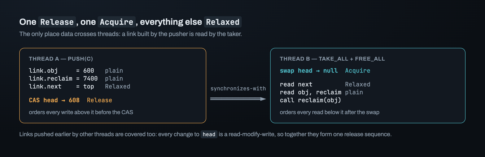
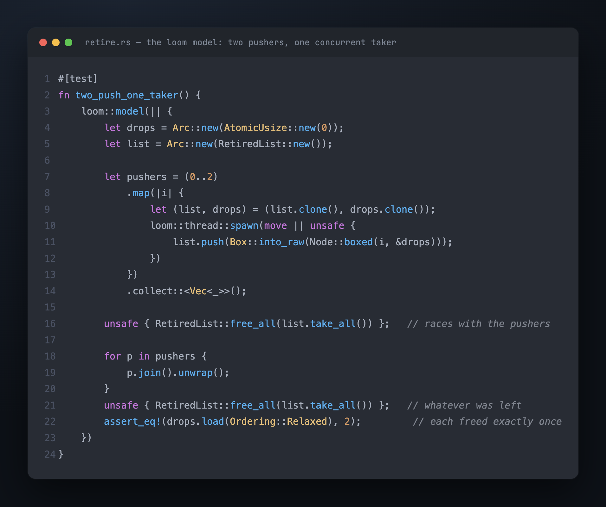
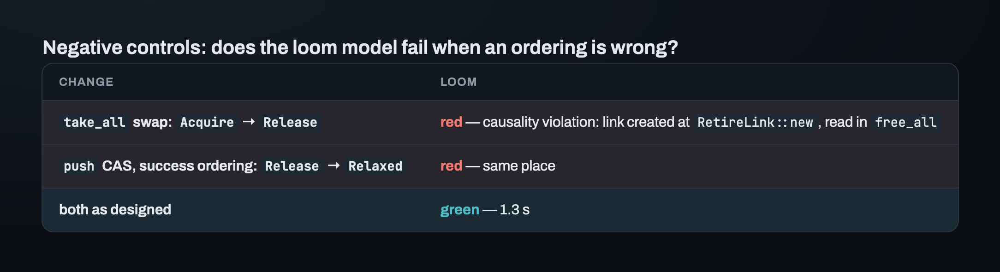
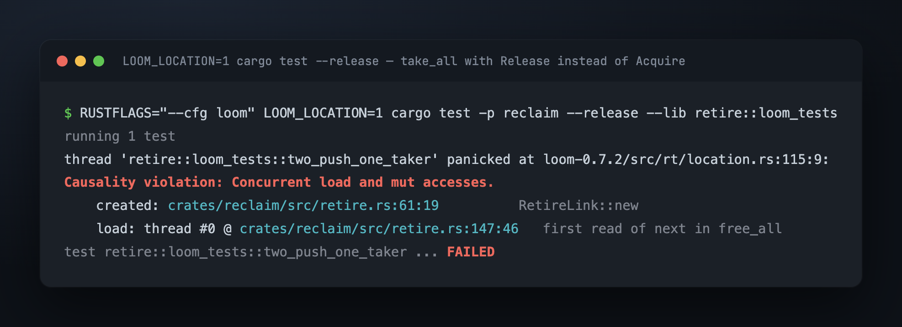

# Part 7 — One `Release`, one `Acquire`, everything else `Relaxed`

On one thread, you can check that the pile is correct by reading its code from top to
bottom. On several threads, nothing guarantees that yet. Thread A pushes a link: it
writes `obj`, `reclaim` and `next`, then does a compare-exchange (CAS) on `head`. Thread
B takes the whole chain with one `swap` on `head` and reads those three fields. An Apple
M2 has a weak memory model: the hardware does not promise that other cores see a core's
writes in order. So nothing forces B to see A's writes in the order A made them, or at
all.

The tempting fix is to make every atomic operation `SeqCst`, the strongest ordering, and
move on. This part does the opposite. It finds the one place data crosses threads, puts
exactly one ordering on each side of it, and uses loom to check that each one is really
needed.

## Where does data cross threads?

Each field of a link has one writer and one reader at a time. Data crosses threads in
one place only: a link written by the thread that pushes it (the *pusher*) is read by
the thread that takes it (the *taker*). The pusher builds the link, publishes it with a
compare-exchange on `head`, and then never touches it again. The taker gets it with a
`swap` on `head`, and then reads it.

So the question is narrow. What makes B's reads in `free_all` see A's writes in `push`?

## The first answer put `Release` on the wrong side

The first version of `take_all` was `head.swap(null, Release)`: "the pile is being
handed over, so release it."

`Release` orders what *this* thread did before the swap. The taker hasn't written
anything, so it has nothing to publish. It needs the opposite promise: its reads *after*
the swap must see what the pusher wrote *before* the compare-exchange in `push`. That's
`Acquire`.

After the fix, the orderings look like this:



> **One `Release` on the compare-exchange in `push` covers all three writes above it.
> One `Acquire` on the `swap` in `take_all` covers every read below it.** Every other
> access is `Relaxed`.

## Why everything else can be `Relaxed`

- **The writes to `obj`, `reclaim` and `next` in `push`.** No other thread can reach the
  link until the compare-exchange succeeds, so the order *among* them doesn't matter.
  Only their order relative to the compare-exchange matters, and `Release` gives that.
- **The load of `head` at the top of `push`, and the compare-exchange when it fails.** A
  compare-exchange takes a second ordering for the failure case. `push` never *opens*
  the old top. It only copies the address into `next` and compares it with `head`. An
  address in a register needs no ordering. A Treiber stack's `pop` does need `Acquire`
  here, because it opens the top. The pile's `push` doesn't.
- **The reads in `free_all`.** All of them come after the `Acquire` swap in program
  order (the order of the code on that thread), so they're already covered.

What about links pushed by *other* threads, further down the chain? The taker's
`Acquire` swap reads the value written by the last compare-exchange on `head`, so it
*synchronizes with* (pairs with) that one directly, not with each pusher. It still
works, because every change to `head` is a read-modify-write: one atomic step that reads
the old value and writes a new one, like `swap` or compare-exchange. A chain of
read-modify-writes on one atomic forms a **release sequence**: an `Acquire` that reads
the end of it synchronizes with every `Release` along it. So one swap covers every link
on the chain, whoever pushed it.

## Letting loom see the `UnsafeCell` accesses

loom runs a small test under every interleaving (every order of the threads' steps) that
the memory model allows. It also tracks `UnsafeCell` accesses, so it can report a race
on them.

That only works if the code uses loom's types. For atomics this is easy: the crate's
`sync` module (a *shim*) exports loom's atomics when the crate is built with
`cfg(loom)`, and the standard ones otherwise. `UnsafeCell` is harder, because loom's
`UnsafeCell` has a different API. The standard one has `.get()`, which returns a raw
pointer. loom's takes a closure instead, `with(|p| ..)` to read and `with_mut(|p| ..)`
to write, so it can record each access.

So, for normal builds, the same `sync` module wraps the standard `UnsafeCell` in a tiny
type with the same two methods. tokio does the same:

```rust
pub(crate) struct UnsafeCell<T>(core::cell::UnsafeCell<T>);
impl<T> UnsafeCell<T> {
    pub(crate) fn with<R>(&self, f: impl FnOnce(*const T) -> R) -> R { f(self.0.get()) }
    pub(crate) fn with_mut<R>(&self, f: impl FnOnce(*mut T) -> R) -> R { f(self.0.get()) }
}
```

The same code compiles both ways, and under `cfg(loom)` loom sees every access to `obj`
and `reclaim`.

## The loom model: two pushers, one taker

A loom test is called a *model*. In this one, two threads push one node each while the
main thread takes the pile and frees it at the same time. Then the main thread joins
both pushers, a final take frees whatever was left, and the drop counter has to read
exactly 2.



Green, in 1.3 seconds. That alone proves little. A model that can't fail is worth
nothing, so each ordering gets a **negative control**: weaken it and check that the
model goes red.



With `LOOM_LOCATION=1` set, loom prints the source location of both racing accesses:



Read what it says. The failing read is the very first one in `free_all`. It is not
ordered after the write that *created* the link, in `RetireLink::new`. Without the
`Release`/`Acquire` pair, the taker can reach a link that, in its view of memory, was
never built.

## loom caught both missing orderings, and that was a surprise

An earlier project built an MPMC ring, a ring-buffer queue with many producers and many
consumers. There, loom gave a *false green*: it passed a broken hand-off, the step where
one thread passes data to another. The reason is that loom treats a `Relaxed`
compare-exchange as stronger than the hardware does. So before this part, the working
assumption was that loom can't be trusted when a hand-off goes through a
compare-exchange.

Here it caught both missing orderings, even though the pile's hand-off also goes through
a compare-exchange. The difference is the order of the steps. The ring claimed a slot
with a compare-exchange and wrote the data *after* it. The pile writes the data *before*
its `Release` compare-exchange. loom checks the pile's order correctly. For the ring's
order, it assumes more than the hardware promises.

> **You can't know in advance whether loom is reliable or blind on a given piece of
> code. A negative control is the only way to find out.**

## Retiring the same object twice, from two threads at once

Part 6's double-retire check reads `reclaim` without synchronization. Two retires of one
object at the same instant race on that cell. The `assert!` might or might not fire.
loom reports the race itself as a causality violation: two accesses to one cell, at
least one of them a write, with nothing ordering one before the other. So the check
covers ordered retires, and loom covers concurrent ones. Neither alone covers both.

## Where this leaves us

The pile is correct across threads with exactly two non-`Relaxed` operations, and each
has a negative control that goes red when its ordering is weakened. Correct isn't the
same as fast. Every retiring thread, on every retire, does a compare-exchange on the
same `head`, one 8-byte atomic in one cache line. The next question is what that costs
with eight threads. The answer missed the prediction by an order of magnitude.

---

*Next: [Part 8 — Measuring the pile: one head, eight heads, and chains](08_measuring.md) · Previous: [Part 6](06_the_pile.md) · [Index](00_index.md)*
