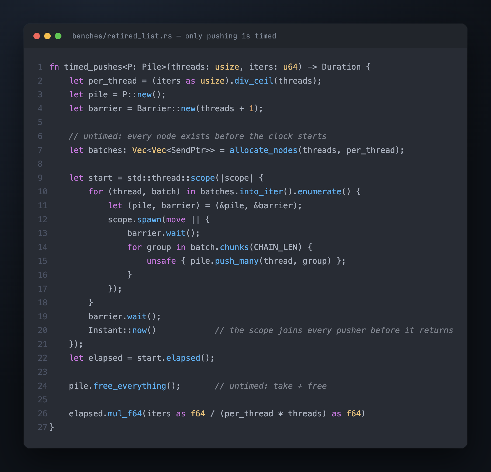
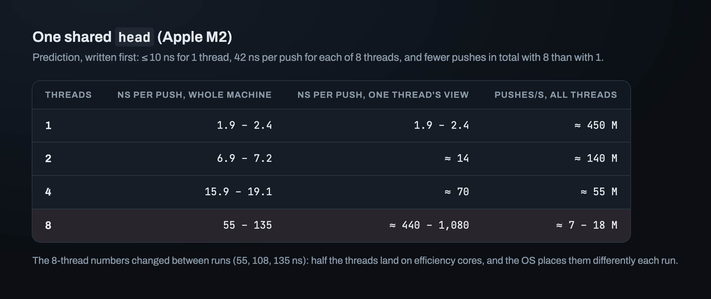
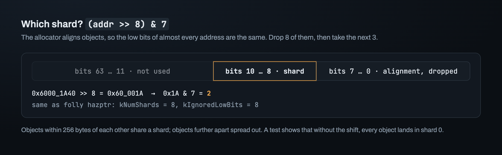
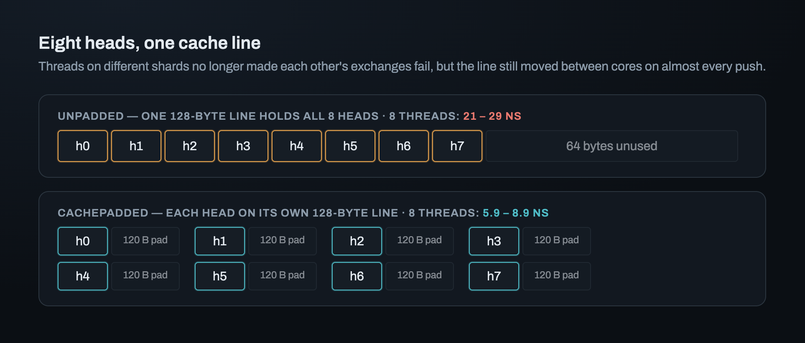
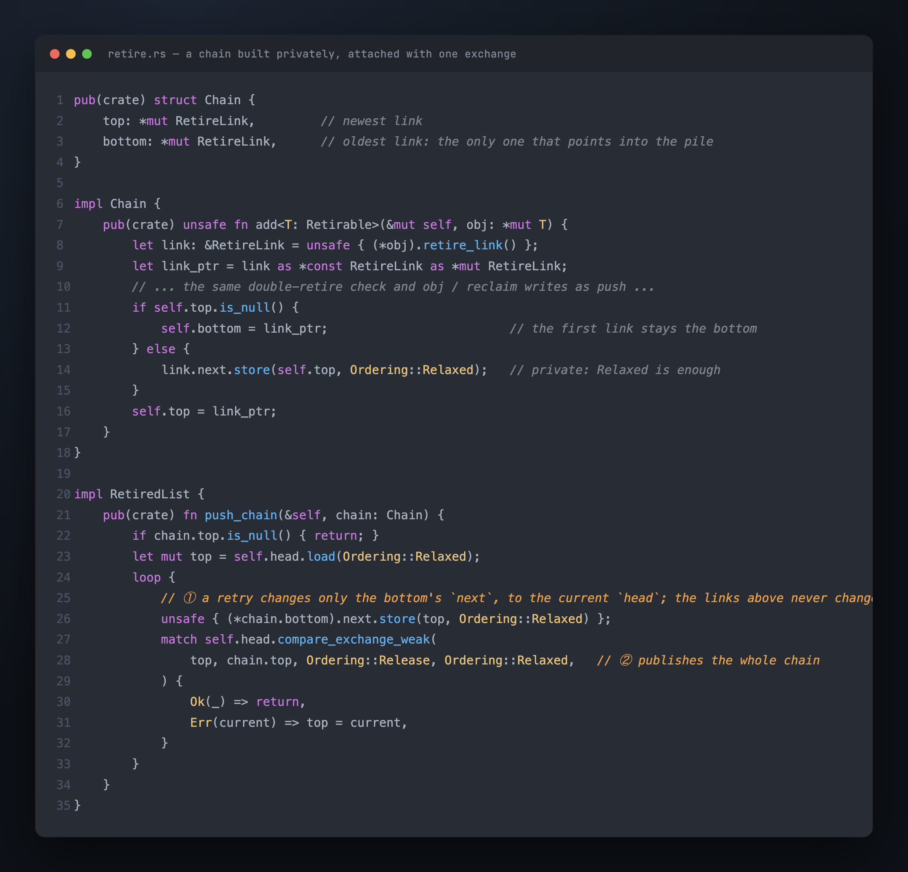
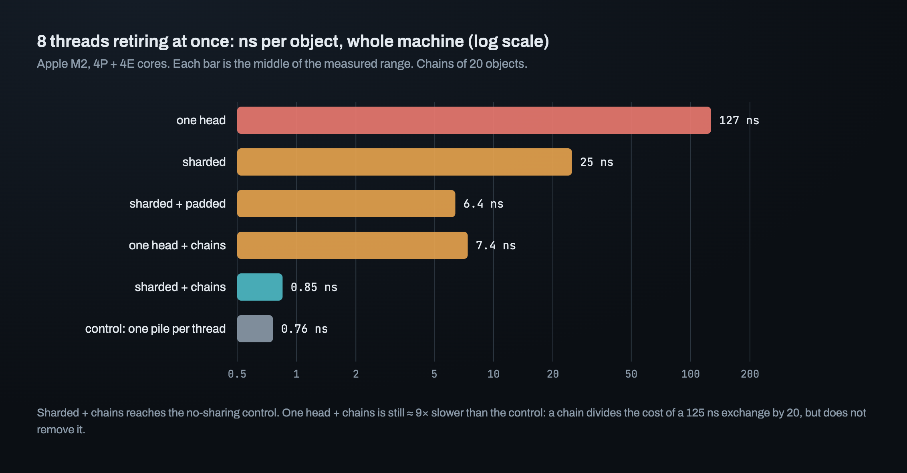
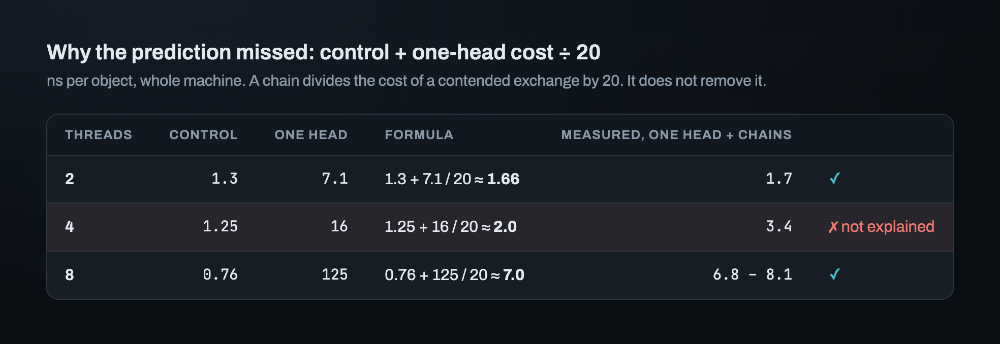
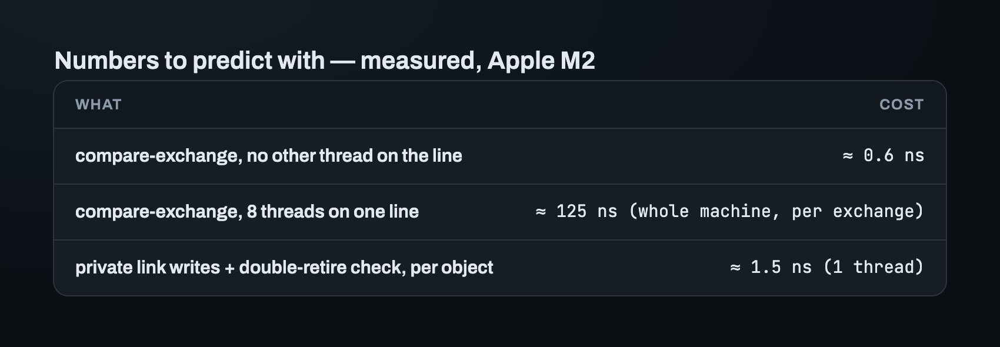

# Part 8 — Measuring the pile: one head, eight heads, and chains

Eight threads retire objects into one pile. Each retire is one compare-exchange on
`head`. The prediction, written before the run, was 42 ns per push for each thread. The
measurement was between 440 and 1,080 ns. One thread alone pushed 25 to 60 times more
objects per second than all eight together.

This part is about that gap and the three changes that closed it: shards, padding and
chains. Every run has a prediction written before it, because a wrong prediction shows
what was misunderstood.

All numbers are from an Apple M2: 4 performance cores, 4 efficiency cores, 128-byte
cache lines.

## What the bench measures, and what it doesn't

- **Only pushing is timed.** The objects are small `Node`s that hold only a link. Every
  node is allocated before the clock starts, and `take_all` + `free_all` run after it
  stops. `malloc` and `free` aren't in the number.
- **All threads start together.** They wait on a `Barrier`, and the clock runs from the
  barrier to the last `join`.
- **The unit is time per push, for the whole machine:** elapsed wall-clock time divided
  by the total number of pushes. As one thread sees it, a push takes that time
  multiplied by the number of threads.

The bench is the worst case on purpose: threads that do nothing but retire. A real
structure retires far less often.

## One shared `head`: the prediction contradicted itself

The prediction, written before the first run: **≤ 10 ns** per push for one thread, **42
ns** per push for each of eight threads, and *fewer* pushes in total with eight threads
than with one.

Even before the run, the two halves disagreed. Eight threads at 42 ns each give about
190 M pushes per second, which is *more* than one thread at 10 ns (100 M/s). The run
would decide which half was wrong.

One thread: about 2 ns, within the predicted ≤ 10 ns. The exchange hits a line already
in this core's cache. Eight threads: the prediction was wrong by 10–25×, as one thread
sees it. The "fewer in total" half was right, and the drop was far bigger than expected.
Two threads together already push only about a third as many objects per second as one.

To push, a core needs `head`'s cache line for itself, with no copy in any other core.
With eight threads, the line moves to whichever core is pushing, and every failed
exchange moves it again for nothing. More threads add no work, only traffic on one
cache line. The 8-thread numbers also changed between runs (55, 108 and 135 ns), because
half the threads land on the slower efficiency cores, placed differently each time.

## Eight heads: which shard does an object go to?

Split the pile into 8 smaller piles, called **shards**, each with its own `head`.
Picking an object's shard has to be cheap and spread objects evenly. folly's `hazptr`
uses the object's address: 8 shards, and the lowest 8 bits of the address are dropped.

Why drop the low bits? The allocator aligns objects, so the lowest bits of almost every
address are the same. `addr & 7` sends every 8-byte-aligned object to shard 0. A test
checks this: without dropping the low bits, every object lands in one shard.

Prediction: **3 ns** for one thread (1 ns more, to pick the shard) and **100 ns** per
push for each of eight threads. The reasoning was "less contention, but not much less".
*Contention* means threads competing for the same cache line.

One thread: no measurable cost; a shift and a mask are lost in the noise. Eight threads: 21–29 ns for the whole machine, which is 170–230
ns as one thread sees it. That is about 2× slower than the predicted 100 ns, and 4–5×
faster than one head. But eight threads on eight shards still pushed about 10× *fewer*
objects per second than one thread on one head.

## The eight heads shared one cache line

Eight `AtomicPtr`s are 64 bytes, and an M2 cache line is 128. All eight heads sat in one
line. Threads on different shards no longer made each other's exchanges *fail*, but the
line still moved between cores on almost every push. That's false sharing: independent
data on one cache line, so every write invalidates the other cores' copies of the line.

The fix is to wrap each shard in `CachePadded`, which gives a value a cache line of its
own: 128 bytes on aarch64. The same eight shards, now on eight lines, take 5.9–8.9 ns at
8 threads. That is 3–4× faster than sharding alone. (No prediction was written for this
run. The bench notes record that as well.)

## A control: how fast could any shared pile be?

Is 5.9–8.9 ns good? There was nothing to compare it with. So the bench gained a
**control**: every thread pushes into its own pile, on its own line. Nothing is shared,
so no shared design can do better on this machine. It isn't a usable design, because no
other thread can take from a private pile.

The control didn't scale well either: 2 threads ≈ 1.3 ns, 4 ≈ 1.2, 8 ≈ 0.75. Part of
the limit is the machine. The nodes are allocated on the main thread, so their cache
lines start in another core's cache, and half the cores are slow. So the target for the
pile isn't "8 threads, 8× faster". The target is the control. Padded shards were still
≈ 2× slower than the control at 2–4 threads, and ≈ 8× slower at 8.

## Chains: one exchange for many objects

The rest of the gap is the exchange itself, one per retired object. A thread that
retires 20 objects fights for a shared line 20 times. Instead, it can link the 20
together privately first, where no other thread can see them and no atomics are needed.
This private list is a **chain**. The thread then attaches the whole chain with **one**
exchange. folly does this in `push_list`.

Two details matter:

- **Only the bottom link is rewritten when the exchange is retried.** The links inside
  the chain point at each other and never change. Only the bottom link points into the
  shared pile, and another thread may change `head` between the load and the exchange.
  Negative control: write `bottom.next` only once, before the loop. The loom model with
  two chain pushers then loses a whole chain (2 drops instead of 4).
- **One chain goes into one shard.** Splitting it by address would cost up to eight
  exchanges, which defeats the point. It's allowed because nothing looks for an object
  by its shard: a round takes all eight. If a later feature needs "every object of kind
  X is in one shard", chains must be split.

Prediction, with chains of 20: **2 ns in every case**, one head or sharded, 1 thread or
8. The reasoning: one exchange per 20 objects is close to free, so only the private
writes are left.

## The result, and a formula for why the prediction missed

**Sharded + chains reaches the control** at every thread count: 1.3 against 1.3 ns at 2
threads, 1.3 against 1.2 at 4, and 0.85 against 0.76 at 8. On this machine, sharing the
pile no longer costs anything you can measure.

**One head + chains** missed the prediction by more than 3× at eight threads: 7.4 ns,
not 2. The prediction treated an exchange as "close to free". That is true when no other
thread uses the line (*uncontended*). With eight threads on one line, the one-head
measurement shows it costs about 125 ns. A chain divides that by 20. It doesn't remove
it:

The formula fits at two and eight threads. It misses at four, and that is not explained
yet.

> **Sharding makes each exchange cheap. Chains make exchanges rare. It takes both to
> reach the control.**

Chains help even one thread: 2.2 → 1.6 ns. The ≈ 0.6 ns difference is about one
uncontended exchange, paid 20× less often.

## Numbers to predict with next time

Three numbers measured here became the starting point for every later prediction:

## Where this leaves us

The pile is done: a three-word link inside every object, one `Release` and one
`Acquire`, eight padded shards, and chains that reach the no-sharing control.

The pile is half of what a round needs. It says what *could* be freed. The other half
says what can't be freed yet: the objects that readers are still holding. Part 3's
readers announce what they hold by writing into slots. A round has to find every one of
those slots, on every core, and no slot may disappear while the round reads it.

---

*Next: [Part 9 — The registry: where readers' announcements live](09_the_registry.md) · Previous: [Part 7](07_orderings.md) · [Index](00_index.md)*
