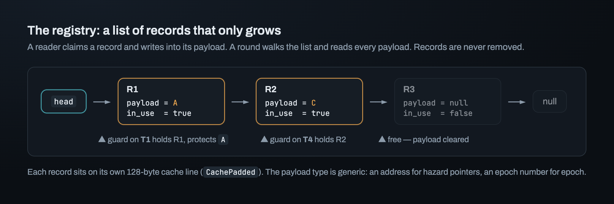
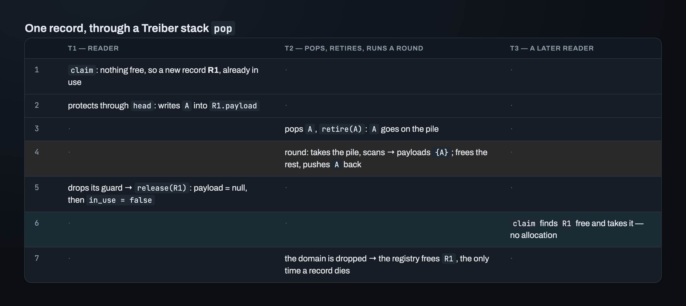
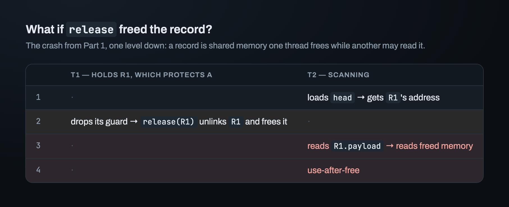
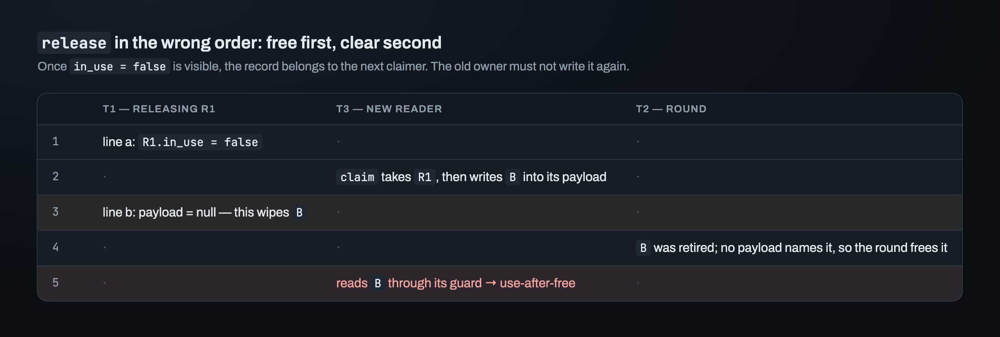
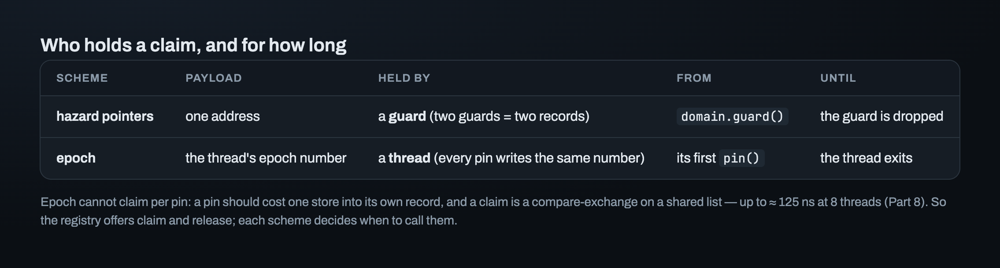
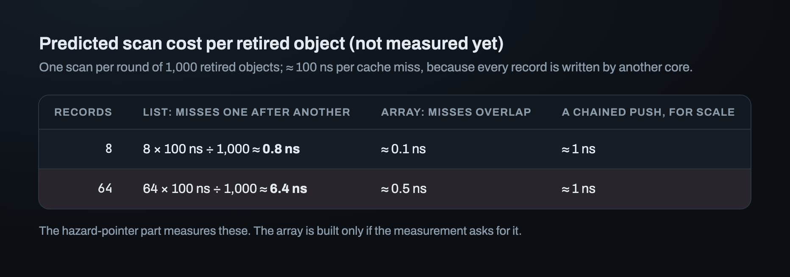

# Part 9 — The registry: where readers' announcements live

A round takes 1,000 retired objects off the pile. On one of eight cores, a reader may
still hold the address of one of them. Part 3 said the reader announces it: it writes
the address into a *slot* that the scheme can read. This part asks where those slots
live. The round must find every one of them, and while the round is reading a slot, the
slot must not disappear.

The answer is the crate's second concurrent component, the **registry**. It looks like
a simpler version of the pile: a list that only grows. Five questions decide its shape.
This part answers them, one trace at a time.

## What a round has to read

Each slot is a **record**. A record holds three things: the **payload** (what the
reader writes: an address for hazard pointers, a number for epoch), a flag `in_use`, and
`next`, the record after it. The registry is the list of all records of one scheme. A
reader **claims** a record before it reads and **releases** it afterwards. Walking the
list and reading every payload is called the **scan**.

The registry decides nothing about *what* is written. Hazard pointers (Part 3) write an
address; epoch writes a number. So the record is generic over its payload type, `P`.

## One record's life

Here's one record followed through a Treiber stack `pop`, assuming hazard pointers:

Two steps carry the design. Step 4: the round reads every payload *before* it frees
anything, and pushes `A` back on the pile, because a payload names it. Step 6: T3 gets
`R1` back instead of a new record. Records are reused, not freed.

## Question 1: why is a record never freed?

Suppose `release` freed the record instead of keeping it. The scan in step 4 runs at
the same time:

This is the crash from Part 1 again, one level down. A record is shared memory that one
thread wants to free while another may still read it. Freeing records safely would need
a reclamation scheme for records, and that scheme would need its own registry.

> **A record is never freed while the registry lives. It's reused.** Records are freed
> only in the registry's `Drop`, when no thread can be scanning.

A single-threaded test can't show this bug, because it needs the scan to pause between
loading `head` and reading the payload. Miri can catch it, but only on a schedule that
pauses there, so it needs many seeds.

## Question 2: in `release`, which write comes first?

`release` does two things: it clears the payload, and it sets `in_use = false`. Here is
what happens in the wrong order, with three threads:

Once `in_use = false` can be seen, the record belongs to the next thread that claims
it. From then on, the old owner must not touch it.

> **Release clears the payload first, then marks the record free.**

This rule also explains why the scan may read free records. Their payloads are always
cleared, so they protect nothing.

## Question 3: does a guard hold a record, or a thread?

The two schemes give different answers:

With hazard pointers, a payload is one address. A thread walking a list hand-over-hand
protects two nodes at once, so it needs two guards and two records.

Epoch's payload is the thread's epoch number. Every pin on a thread writes the same
number, so one record per thread is enough. And it *must* be per thread: `pin()` runs on
every operation, and it should cost one store into the thread's own record. If every pin
claimed a record, each pin would pay a compare-exchange on a shared list. Part 8 measured
that at up to 125 ns with eight threads.

So the registry doesn't decide who holds a claim. It offers `claim` and `release`, and
each scheme calls them when it needs to. Handing a record back when a thread exits is
epoch's problem, and it moved to the epoch part of the crate.

## Question 4: a list, or an array?

folly keeps records in an array that only grows. The registry here is a linked list,
like the pile. What does each cost?

The scan runs **once per round**, not once per retired object. It reads every payload
into a set, and then each retired object is one lookup in that set. Checking each
object against every record would cost retired × records. Building the set first costs
retired + records.

On a scan, every record is a cache miss, because its owner writes it from another core.
In a list, the CPU can't load `R2` until it has read `R1.next`, so the misses happen one
after another. In an array, every address is known in advance, so the misses overlap.

At 8 records, the list costs less than the push did. At 64 records, it costs six
times as much. These are predictions, and the hazard-pointer part measures them.

> **Build the list. Switch to the array only when a measurement asks for it.**

## Question 5: why is every record padded?

Every `protect` writes its own record's payload, on every operation. If two records
shared a cache line, two readers on two cores would keep pulling that line away from
each other. Part 8 measured that kind of false sharing at 3–4× on the shards. So each
record is wrapped in `CachePadded` and gets a 128-byte line of its own.

## Where this leaves us

Five answers and two rules: records are immortal, `release` clears before it frees, the
scheme decides who holds a claim, the registry is a list for now, and every record is
padded. That's the design.

Turning it into code raised three more questions. Which of the three fields must be
atomic? Can the registry be sent to another thread? And which orderings does it need?
The first loom model to answer the last question passed with every access `Relaxed`. It
couldn't have failed.

---

*Next: [Part 10 — Three fields, two ordering pairs, and a loom model that couldn't fail](10_registry_correctness.md) · Previous: [Part 8](08_measuring.md) · [Index](00_index.md)*
