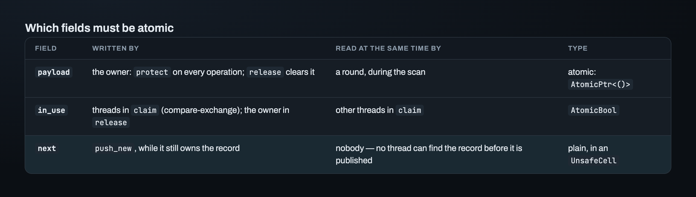
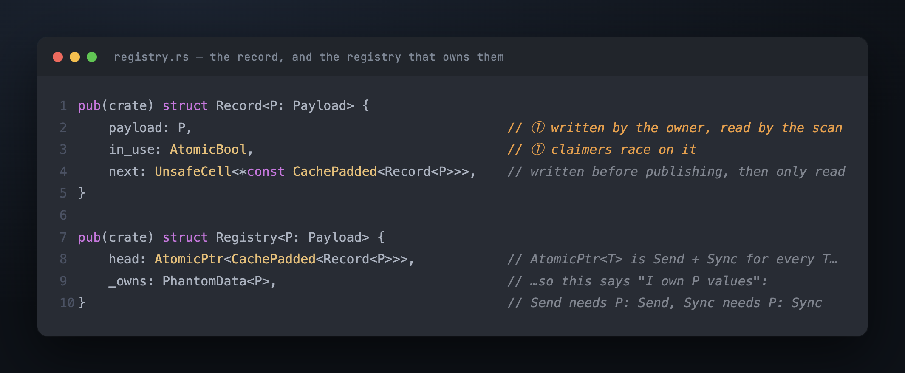
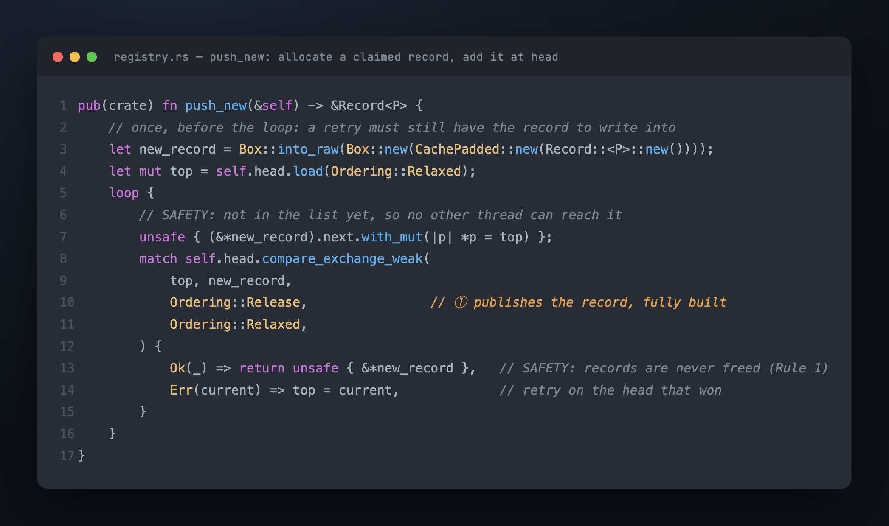
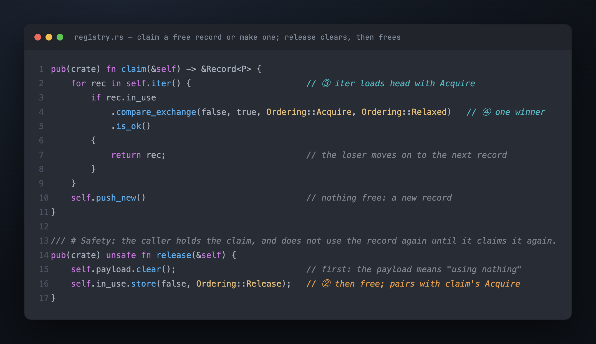
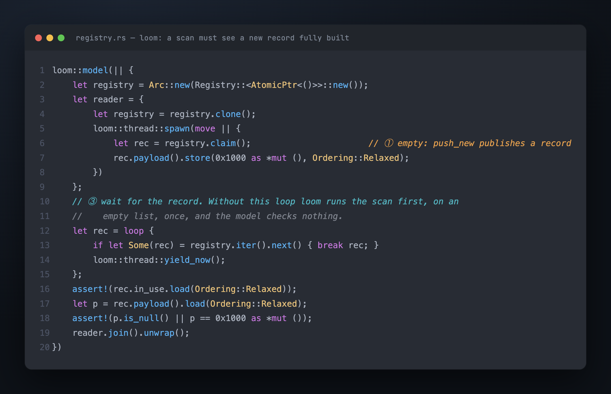
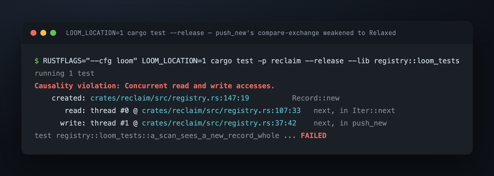
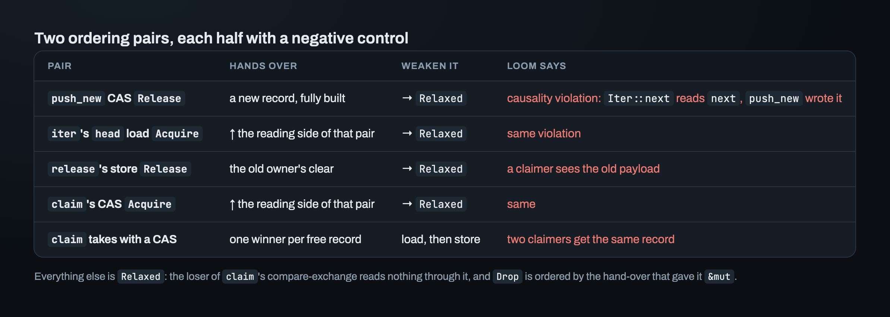

# Part 10 — Three fields, two ordering pairs, and a loom model that couldn't fail

The registry's first loom model passed in a fraction of a second, with every atomic
`Relaxed`. A model that checks a memory ordering shouldn't pass with no orderings at
all. This one would have passed with any code: loom ran it exactly once, and in that
one run the thread under test never saw a record.

This part turns Part 9's design into code. Four questions come up on the way: which
fields must be atomic, whether the registry may move between threads, why its `Drop`
needs no synchronization, and which orderings it needs. The last question is where the
model went wrong.

## Which fields must be atomic?

Two questions decide it, for each field:

1. Can another thread read the field while it's being written?
2. When it's written, does the writer hold `&`, or does it own the value?

A "yes" to the first means the field must be atomic. Holding only `&` means a plain
field can't be written at all, so it needs an atomic or an `UnsafeCell`.

`next` is the interesting row. `push_new` creates the record, so it owns the record
while it writes `next`, and no other thread can find the record until the
compare-exchange on `head` succeeds. After that, nobody writes `next` again.

The pile's `next` (Part 6) *is* atomic, and the reason is not threads. The scheme
reaches a link only through `retire_link(&self) -> &RetireLink`, inside someone else's
object. With only `&`, a plain field can't be written. The registry owns its records, so
that constraint doesn't apply here.

`next` sits in the crate's `UnsafeCell` wrapper (Part 7). In normal builds it's a plain
field. Under loom, every read of it is checked against the write in `push_new`, as
shown below.

## The compiler said `Send + Sync` without looking at `P`

A check like `fn needs<X: Send + Sync>()`, called with `Registry<AtomicPtr<()>>`,
compiled with no `unsafe impl` at all. The registry's only field was an
`AtomicPtr<Record
>`. `AtomicPtr<T>` is `Send` and `Sync` for **every** `T`, so the
compiler never looked at `P`.

But the registry owns the payloads. If it moves to another thread and is dropped there,
the payloads are dropped on that thread too, so it needs `P: Send`. And if two threads
share `&Registry`, both read `&P` at the same time, so it needs `P: Sync`. Before the
fix, only the bounds on the `Payload` trait carried those two requirements. Delete them,
and everything would still compile, unsoundly.

> **`PhantomData
` tells the compiler that the registry owns `P` values.** After it,
> `Registry` is `Send` only if `P: Send`, and `Sync` only if `P: Sync`, and the compiler
> checks both.

## `Drop` uses `Relaxed`, and that's enough

`Drop` walks the list with a `Relaxed` load and plain reads, then frees every record.
Pushing onto this same list needs a compare-exchange loop, shown below.

"Nobody writes it anymore" is half of the reason. `&mut self` means no other thread can
reach the registry, so nothing is written while `Drop` reads. That rules out a race. It
doesn't explain why `Drop` *sees* the records other threads pushed. The other half
happened before `drop` was called: a thread gets `&mut` only through something that
synchronizes, such as the last `Arc` being dropped or a `join`. That hand-over already
ordered every earlier `push_new` before `Drop` runs.

## `push_new`: the borrow checker found one of three bugs

The first version called `Box::into_raw` inside the loop. The compiler rejected it:
the first try gives the box away, so a retry has nothing to write `next` into. Two more
bugs were in the same loop, and the compiler can't see either one. A failed exchange
never updated `top`, so the loop retried the same stale value forever. And a successful
exchange didn't return, so the loop pushed the same record again.

A test that pushes three records and walks the list now catches the "pushed but not
linked" case. Negative control: a `push_new` that skips the loop gives an empty list.

## `claim`: the tests went red first

The first `claim` returned a record when `in_use` was **true**, taking a record someone
else was using. The tests for "two claims give two records" and "release then claim
gives the same record" were written first, ran against that version, and both failed.

The same version also took a free record with a load and then a store, not a
compare-exchange. No single-threaded test can show that bug. Loom can: two threads claim
from a registry with one free record. With a compare-exchange, they always get different
records. With a load and then a store, loom finds the run where both take the same one.

## The loom model that couldn't fail

The second model checks that a scan sees a newly pushed record fully built. One thread
claims from an empty registry, so `push_new` publishes a new record. The main thread
scans at the same time and checks whatever it finds.

It passed with every access `Relaxed`. Weakening `push_new`'s compare-exchange, the
negative control, didn't change that. Counting loom's runs showed why: the
two-claimers model ran 27 interleavings, and this one ran **1**. In that run, the scan
started before the other thread had pushed anything, found an empty list, and checked
nothing. A `panic!` placed inside the scan loop still passed.

The fix was to make the scan wait until it finds the record:

Now it fails without the ordering, and loom points to the exact read:

> **A model whose interesting interleaving never runs is green for free.** Before
> trusting a green loom model, put a `panic!` where the model must reach and check that
> it fires.

## Two ordering pairs, four negative controls

The fixed model, plus a third one for Part 9's second rule, settle the orderings:

The second pair was a real bug, and the program order in `release` was already right.
`release` clears and *then* frees, as Part 9 requires. But with both stores `Relaxed`,
the hardware may make them visible to other cores in the opposite order. The third
model caught this: a thread claimed a released record and still saw the old owner's
address. That's Part 9's three-thread trace, with the CPU reversing the order instead of
the code.

That model was first written in the same empty way as the second one: the claim ran
before the other thread had made a record. Its negative control stayed green, which gave
it away.

## Reuse: 64 threads, one record

The last test is an ordinary one. Sixty-four threads run one after another, and each
one claims, writes, releases and exits. Each is joined before the next starts, so there
is exactly one possible order, and the registry ends with **one** record. Negative
control: a `claim` that never reuses ends with 64.

Reuse limits the record count to the most claims ever **held** at the same moment, not
to the number of cores. A thread blocked on I/O still holds its guard's record. And the
count never goes down: one burst of 512 guards leaves 512 records, and every later scan
walks all of them. folly limits this growth with per-thread caches that give unused
records back after a while, and with records per CPU. Neither is built here. Both
depend on parts that don't exist yet.

## Where this leaves us

The registry is correct across threads: 8 tests, Miri, three loom models, and a
negative control that fails for every ordering and every check. Records can be claimed,
released, reused and scanned.

The crate now has both halves of a round: the pile of retired objects and the list of
readers' records. Nothing runs a round yet. When should one start, and which thread
should pay for it? A retiring thread that runs a round inside its own `pop` adds the
round's whole cost to that `pop`'s latency.

---

*Previous: [Part 9](09_the_registry.md) · [Index](00_index.md)*
